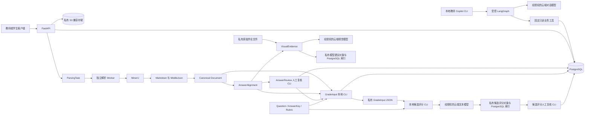

# 慧批云端

慧批云端是一个独立重建的高中 AI 教学辅助平台。项目先建立可信的作业数据与来源链路，为教师检查学生提交、解析作业内容和复核作答证据提供后端能力。

当前系统支持作业管理、学生作业文件提交、文档解析、题目来源对齐、视觉证据建议、人工作答复核，以及基于当前人工确认文本与 Rubric 生成候选评分。模型输出只供人工检查，不是最终成绩或教学结论。

## 功能特性

- **作业与题目管理**：创建作业、维护题目、人工录入标准答案和评分细则，并校验后发布。
- **作业提交与文件存储**：提交 PDF、JPG 或 PNG，使用私有 S3 兼容存储保存原文件。
- **文档解析**：通过独立配置的 MinerU 4.x Basic/ONNX 运行时生成 Markdown 和结构化解析产物。
- **文档标准化**：将 MinerU 结果转换为带来源信息的 Canonical Document。
- **题目来源对齐**：识别题号候选、切分可追溯内容区域，并与作业题目进行保守匹配。
- **视觉作答证据建议**：调用经授权的云端视觉模型，生成与人工复核分离的视觉建议。
- **人工复核与评测**：记录版本化的人工作答判断；提供合成数据评测工具，用于检查协议、作答判断和区域定位表现。
- **评分输入准备**：从当前人工确认的 Canonical 文本范围构建不可变输入包，并快照教师标准答案与 Rubric；不调用评分模型或产生分数。
- **Rubric 候选评分**：受控本地 CLI 可调用配置的文本模型，为每个评分项生成候选分数、理由和可核验的原文引用；不会发布成绩，也不会修改人工复核记录。
- **候选评分人工复核**：受控本地 CLI 可接受、修订、拒绝候选分数或标记需要重新评分，并保留不可变修订历史；记录不等于正式成绩。

- **教师 Copilot**：受控本地 CLI 可调用云端模型查询指定作业、题目、Rubric 和提交处理状态；只读、不发布成绩。

## 系统架构



`VisualEvidence` 保存独立的模型建议，不会自动写入 `AnswerReview` 人工决定。候选评分人工复核单独追加到 PostgreSQL，不会改写模型 Proposal 或发布成绩。PostgreSQL 保存业务记录和索引；对象存储保存原始文件及大型不可变产物。

## 技术栈

- Python 3.12、uv、FastAPI、Pydantic Settings
- PostgreSQL、SQLAlchemy 2.x Async、Alembic
- S3 兼容对象存储与 boto3；本地 Compose 使用 PGSTY SILO
- MinerU 4.x Basic/ONNX 独立运行时
- pypdf、pypdfium2、Pillow、HTTPX
- LangGraph（受控 Copilot 状态流程）、pytest、Ruff

## 快速开始

需要 Python 3.12、uv 和 Docker Compose。下面命令启动仅绑定本机端口的 PostgreSQL 与对象存储：

```bash
cp .env.example .env
uv sync --locked
docker compose up -d postgres minio
uv run python scripts/init_minio_bucket.py
uv run alembic upgrade head
uv run uvicorn huipi_cloud.main:app --reload
```

API 文档位于 <http://127.0.0.1:8000/docs>，存活检查为 `GET /api/v1/health`。数据库表由 Alembic 管理，应用启动时不会自动创建表。

## 基本使用

基本流程是：创建并发布作业 → 上传一份学生作业 → 运行解析 Worker → 标准化文档 → 对齐题目来源 → 可选地生成视觉建议 → 人工作答复核 → 准备文本评分输入 → 可选地生成并人工复核 Rubric 候选评分。

最小可执行 API 示例和完整本地处理步骤见[作业处理教程](docs/development/basic-workflow.md)。MinerU和云端模型API需要单独配置，快速启动不会自动安装模型或启动解析 Worker。

## 主要接口

后端 API 统一使用 `/api/v1` 前缀，完整的请求和响应结构可在本地 `/docs` 查看。

| 能力 | API 入口 |
| --- | --- |
| 创建、查询和发布作业 | `/assignments`、`/assignments/{id}/publish` |
| 上传和查询学生提交 | `/assignments/{id}/submissions`、`/submissions/{id}` |
| 读取解析任务和 Markdown | `/submissions/{id}/parsing-task`、`/submissions/{id}/parsed-document/markdown` |
| 读取 Canonical 页面 | `/submissions/{id}/canonical-document/pages/{page_number}` |
| 读取题目来源对齐 | `/submissions/{id}/answer-alignment/questions/{question_id}` |

视觉建议与人工复核目前通过受控本地 CLI 运行，操作步骤见[开发指南](docs/development/README.md)。

## 当前边界

- 系统没有完整登录、RBAC 或租户隔离。`student_ref` 是本地模拟标识；提交、查询、下载和复核工具只适用于受控环境，不能直接暴露到公网。
- `aligned` 只表示来源区域与作业题目的映射证据足够，不表示学生已作答、OCR 完整或可以评分。
- `ready_text` 只表示文本评分输入通过来源门禁，不表示已产生分数、图像/表格/公式均可评分或人工标签绝对正确。
- 视觉和文本模型都只生成候选建议；候选分数不是最终成绩，尚无经充分验证的真实教学作业评分质量，没有自动发布成绩；教师 Copilot 只提供本地只读 CLI，不具备教师认证或公网服务权限。
- 当前视觉评测集由合成样本构成；合成结果不能代表真实学生作业表现。

## 项目文档

- [架构与模块边界](docs/architecture.md)
- [本地开发指南](docs/development/README.md)
- [评分输入准备指南](docs/development/grade-input.md)
- [Rubric 候选评分 CLI 指南](docs/development/grade-proposals.md)
- [候选评分人工复核 CLI 指南](docs/development/grade-review.md)
- [教师 Copilot 本地 CLI](docs/development/teacher-copilot.md)
- [路线图](docs/roadmap.md)
- [视觉证据评测方法与基线](docs/evaluation/visual-evidence.md)
- [题目来源对齐评测说明](docs/evaluation/answer-alignment.md)
- [文档维护规则](docs/contributing.md)
