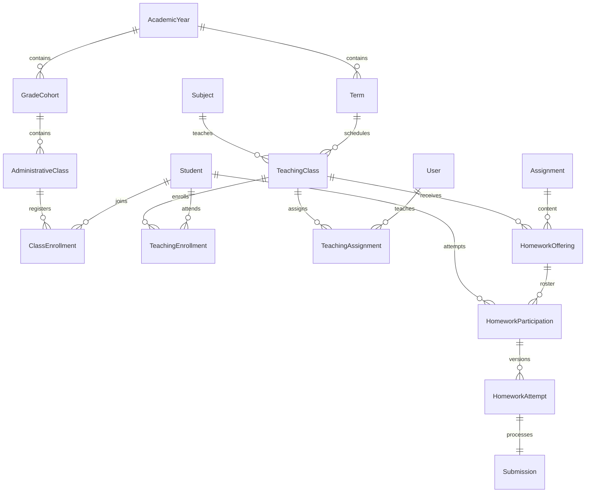
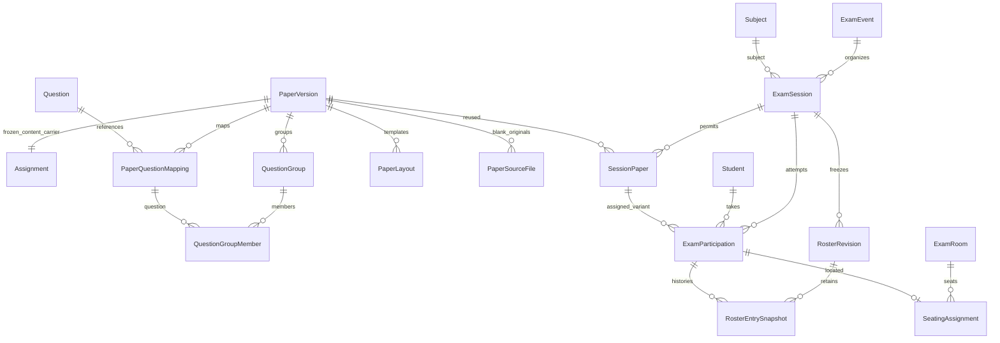
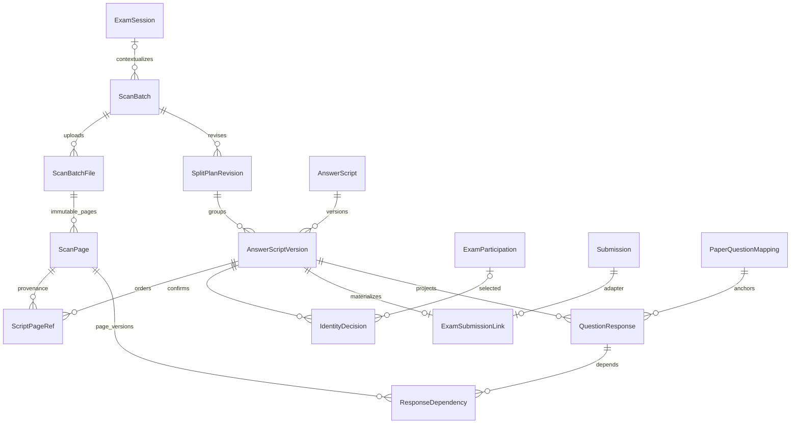
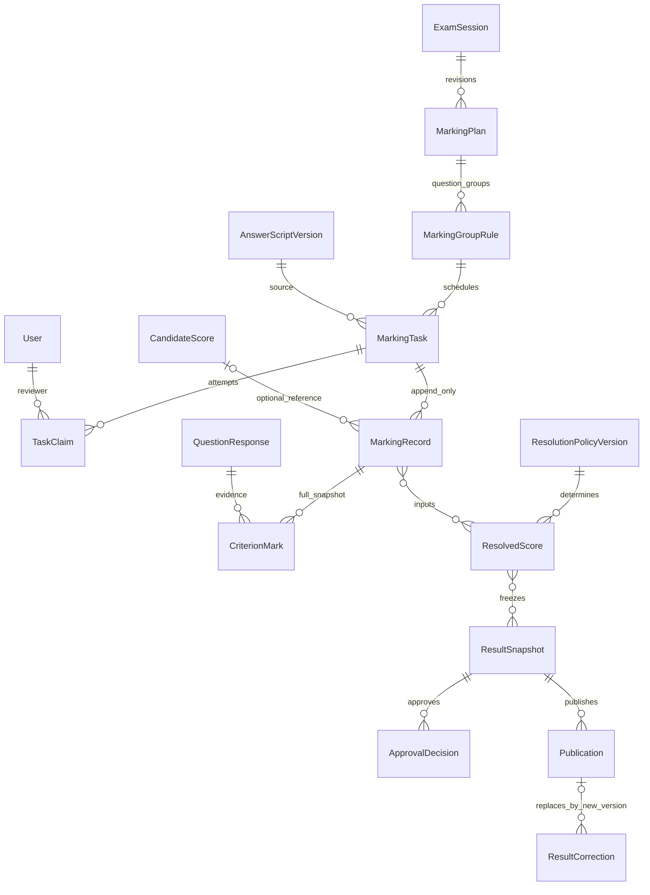
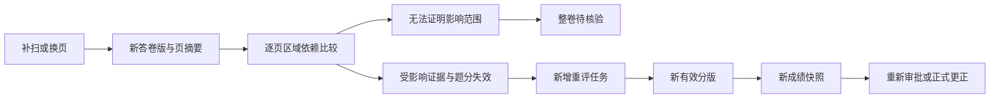
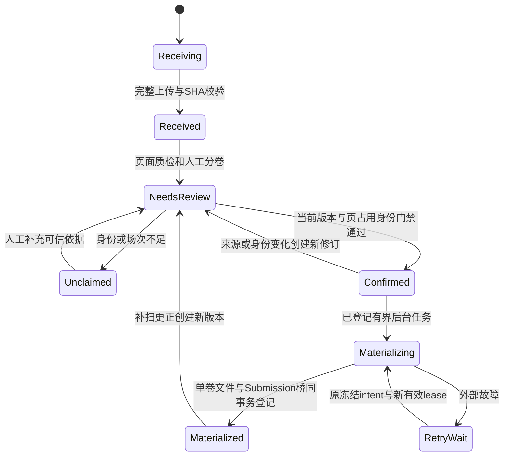
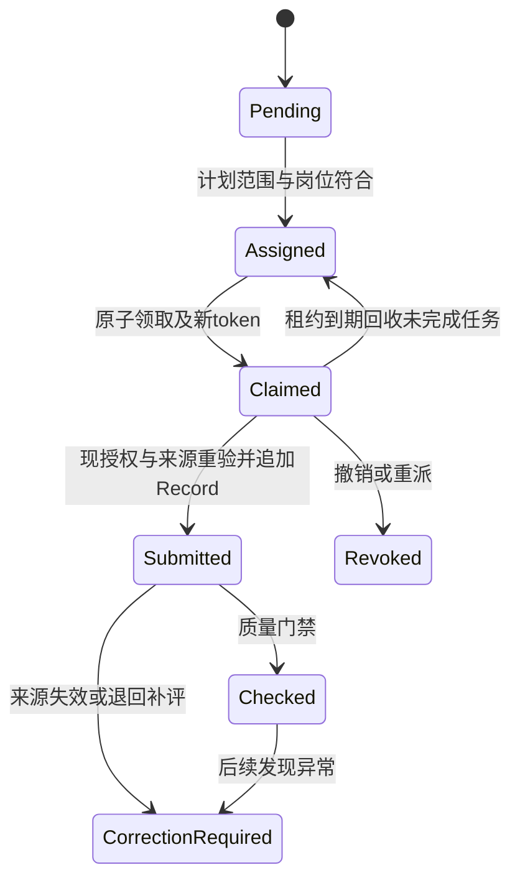

# 单校组织、考试扫描与协同阅卷领域设计

日期：2026-10-18。**设计建议，待审查；表名/状态不是现有实现。**

依据：[需求基线](../product/requirements/school-exam-baseline-v1.md)、[真实模型清单](../product/current-contract-inventory.md)。采用 [ADR-0001](decisions/0001-school-exam-compatible-extension.md)。学校政策问题集中见[评审索引](../product/stage-a-review.md)。

## 1. 聚合与可信边界

1. Organization：学年/学期、年级、行政班、教学班、学科、人员关系；不引入跨校 tenant。系统有单校配置，不以租户框架增加复杂度。
2. Homework：Assignment 内容 + HomeworkOffering 布置 + 名单/提交尝试；现有 Assignment/Submission 继续为 legacy 路径。
3. Paper：PaperVersion 冻结内容、题目映射与 PaperLayout；不含考试名单。
4. Exam：ExamEvent、Session、SessionPaper、RosterRevision、Participation；只权威决定场次与参试归属。
5. Scanning：Batch/File/Page、SplitPlanRevision、Script/Version、IdentityDecision、Materialization；拥有物理页来源，不拥有分数。
6. Evidence：现有解析/Canonical/Alignment/AnswerReview + 新 QuestionResponse 版本投影；机器建议与人工事实隔离。
7. Marking：计划、轮次、任务、不可变记录；认定谁可以评哪个题，不由任教班推导。
8. Results：有效题分、冻结快照、审批/发布/更正；第一闭环没有发布接口。
9. Access/Audit：可信主体、受限 action 目录、带范围授权、业务审计；不能仅在 Vue 隐藏身份。

聚合内短事务；跨聚合通过明确 FK、摘要、幂等操作推进，不通过同名字段/自由字符串猜关联。

## 2. 关系全景

图分为四部分以便评审；均为逻辑设计，B 仅实施最小子集。

MarkingTask 可为整卷/题组工作单元，CriterionMark 必须分别落到题目；整卷任务不能只保存一个不可拆分总分。两处多对多需要实体连接表（ResolutionInput、ResultSnapshotItem），不依赖 JSON 中的无约束 UUID。CandidateScore 为候选逻辑视图，可引用既有 GradeProposal 或未来 OMR 候选。

## 3. 组织与作业设计

### 3.1 组织与历史快照

- AcademicYear(id, code 唯一, start/end)，Term(year_id, code 唯一于学年, start/end)；时间范围正序，跨学年关系拒绝。
- GradeCohort 是入学届别/学段，年级称谓随学年解释；不把“高二”当稳定标识。
- AdministrativeClass(cohort_id, code)，ClassEnrollment(student_id, class_id, valid_from/to)；同一时点只一个当前行政班，使用排他时间范围约束或写入锁验证。
- TeachingClass(term_id, subject_id, code)，TeachingEnrollment 独立，可跨行政班/走班；TeachingAssignment(user_id, teaching_class_id, role, validity) 不隐含阅卷权限。
- Student(id, school_student_code 唯一, minimal_name, active)。姓名不唯一，不采集身份证/家长联系方式作为前置；可信导入批次保留责任人和冲突预检。
- ExamRoom 是物理场所，SeatingAssignment 是场次座位，不修改班级关系。名单冻结时保存行政班/教学班/年级/姓名展示/考号快照并限权读取，转班不回写历史。

### 3.2 作业不等于考试

Assignment 继续是旧内容载体；新 HomeworkOffering(assignment_id, teaching_class_id, due_at, policy_revision) 实现同内容多班布置。HomeworkParticipation 是应交名单，缺交从名单减有效尝试计算，不从不存在的 Submission 推测。

HomeworkAttempt(participation_id, attempt_no, submission_id, submitted_at, reason) 和 CurrentHomeworkAttempt 指针选择有效版本；`on_time/late/makeup/resubmitted` 与处理状态分开。旧一次提交合同保持；新尝试使用服务端不透明处理 ref 和受控桥接，不改旧 unique。日常作业重交上限/有效选择需学校明确，默认不自动覆盖。

## 4. 试卷、场次、名单

### 4.1 试卷不可变性

PaperVersion(id, paper_family_id, revision, canonical_assignment_id UNIQUE, content_sha256, question_digest, rubric_digest, locked_at, status)。同一内容版可多 Session 共享；不对同一内容载体登记多个具有不同评分语义的“冻结版本”。

PaperQuestionMapping(id=稳定 question_key, paper_version_id, legacy_question_id FK, printed_label, order_index, equivalence_group_id 可空)。唯一 `(paper_version_id, legacy_question_id)`、`(paper_version_id, order_index)`；`printed_label` 不作跨卷身份。A/B 若题序不同，显式映射各卷 Question 到已核实逻辑题，等价关系仍是需审核事实。

PaperSourceFile(id, paper_version_id, file_role=question_book/blank_answer_card, bucket/object_key 内部字段, sha256, size_bytes, content_type, created_at) 保存不含学生作答的题本/空白答题卡原件；锁卷摘要包含已采用原件清单。草稿可新增原件，锁后更换产生新卷版，原件不覆盖。原始材料导入是优先入口，可人工核对题目/Rubric后锁版；解析提议非第一闭环前置。

PaperLayout(id, paper_version_id, layout_revision, kind=full_paper/answer_card, source_file_id FK, coordinate_system, regions_manifest_sha, status)。题本与答题卡可分离；无模板时 layout 可空，显示自动配准不可用。冻结后禁止 UPDATE/DELETE 内容字段（未来迁移触发器/权限双保障）；只能新版本和旁表撤销/有效性事件。Rubric 改变须新版本/新策略，旧 snapshot 不变。

现有 published Assignment 仅通过业务 Service 阻止编辑，不等于数据库级 PaperVersion 冻结。新增锁卷服务需检查全部编辑路径和直接管理工具，并在 DB 对已绑定内容提供防变更约束；本轮没有新增该机制。

### 4.2 场次与参试

ExamEvent(id, term_id, name, organizer, revision)；ExamSession(id, event_id, subject_id, start/end, lifecycle, revision)，另设扫描/阅卷进度投影，避免 scanning/marking 互斥。不同时间的同卷可建立不同 Session；同一场次跨考场通过座位安排，不靠克隆试卷。

SessionPaper(session_id, paper_version_id, scoring_policy_version_id) 唯一组合；可含 A/B。ExamParticipation(id, session_id, student_id, attempt_no, session_paper_id, participation_status) 唯一 `(session_id, student_id, attempt_no)`，复合 FK 确保 SessionPaper 同场次。补考通常新 Session，并以 makeup_of_participation_id 追溯，不能靠改旧到考状态抹历史。

RosterRevision(session_id, revision, digest, locked_at) + RosterEntrySnapshot(revision_id, participation_id, class snapshots, exam_candidate_number)。当前指针指向审核过名单；更正产生新 revision，不 UPDATE 历史。考号在同 Session/名单版唯一，名字不唯一。确认身份同时校验参试记录当前有效、试卷允许、未撤回和冲突占用。考务 `absent`、收卷 `not_scanned`、人工 `blank_confirmed`、评分 `score_zero` 独立。

## 5. 批次、分卷与答卷来源

### 5.1 原件与上传

ScanBatch(id, session_id 可空, creator_user/device, revision, state)。未归属区不选默认最新考试。ScanBatchFile(id, batch_id, upload_request_id, sha256, size_bytes, original_filename, private_object_id, page_count, intake_state)。同批次上传请求唯一；内容 SHA 用于重复提示，不跨场次全局去重成同一答卷。

ScanPage(id, file_id, source_page_index, original_page_sha, width/height, unit, transform_version, qc_state)。唯一 `(file_id, source_page_index)`，页码从 0 开始，UI 从 1 开始；原始页不改。旋转/矫正产生派生图与可验证变换矩阵。存储键只内部记录；API 以授权资源 ID 取图。

大批次独立流式暂存、分片/完成合同；首切片仅 PDF，建议初始上限 512 MiB/1,600 页（设计初值，须资源实测确认），像素解码/CPU/磁盘/并发另有限额，不能沿用 20 MiB 接口或无界解码。加密/坏 PDF、签名不符、超配额拒绝；恶意载荷扫描未部署时进入隔离，禁止宣传已防病毒。

### 5.2 分卷与页面占用

SplitPlanRevision(id, batch_id, revision, parent_id, digest, actor, state) 为不可变方案。AnswerScript 是稳定逻辑卷；AnswerScriptVersion(id, script_id, revision, split_plan_id, session_paper_id, pages_digest, prior_version_id) 为一次完整页序快照。ScriptPageRef(version_id, order_index, page_id, role=main/extra, transform_id) 唯一页序和页引用；允许跨批次补扫，但所有批次须同已确认 Session，未知归属先纠正上下文。

**关键并发约束**：仅 `(split_plan_id,page_id)` 唯一不足以防止两个批次/两个计划重复占页。增加 CurrentPageAllocation(page_id PRIMARY KEY, script_id, current_version_id)；确认事务锁定受影响 page_id 按 UUID 排序，校验已占用者。同一 script 新版可沿用旧页；其他 script 拒绝。共享封面等特殊页仅以显式 shared_non_response 标识且不可作为两人的评分证据；首切片不开放共享响应页。

答卷整体更换在同事务交换 CurrentScriptVersion 与页占用，旧 ScriptPageRef 不删。撤销需确认无下游依赖，或先将依赖标失效，再释放占用并追加原因。跨批次页归组不靠 scan_order 等于身份。

### 5.3 身份和完整性是两道门

IdentityCandidate 保留候选/证据/冲突，不是确认。IdentityDecision(version_id, participation_id, roster_revision_id, actor, request_id, reason, basis_digest) 追加；姓名候选不能自动核实。CurrentParticipationScript(participation_id UNIQUE, script_id UNIQUE) 锁定当前尝试归属；重扫同 script 新版，另一份重复卷必须冲突仲裁，不自动产生第二个有效提交。

未认领可保存、质检、试解析，但不生成正式关联 Submission。身份已核实但缺页可生成明确 `incomplete` 的桥接处理对象用于解析；**不得创建可评分/可合分的完整事实**。首切片保守默认缺页暂不物化，保留人工修复队列。附加页不被当作异常固定页数删除。

同卷的图像只能支持模板候选；场次必须有可信 Batch/确认上下文。身份和 Session 不可确定时阻断正式归属，原因是图像缺少足以唯一识别人/场的信息，不能用模型置信度弥补。

## 6. 接入既有 Submission 的最小桥

ExamSubmissionLink(id, script_version_id UNIQUE, submission_id UNIQUE, participation_id, session_paper_id, source_manifest_sha, adapter_version, created_at)。复合 FK/事务检查确保四方属于同一场次/试卷。`student_ref = 'exam_sv_' + script_version_uuid.hex`（40 字符），只供旧引擎处理；禁止旧公网上传使用保留前缀。真实人员关系不从字符串反解。

- 一个锁定 PaperVersion 引用一个 Assignment；两 Session 共用内容，用不同 script_version refs 避免旧唯一键冲突。
- 每版独立文件、解析任务和产物；不 UPDATE 旧 SubmissionFile 或抢占原 ParsedArtifact。
- 生成的单卷 PDF 有页 manifest：合成页序 → ScanPage/file/source_page_index/变换/摘要，涵盖附加页。超出现有解析单卷上限须显示 resource_limit 阻断或下一切片显式支持分页解析，不能静默截断/假成功。
- 适配器是可信应用服务：S3 上传完成后新短事务同时写 Submission/File/Task/Link/操作结果；不能嵌套调用旧自提交 Service。
- 新桥接 Submission 先于 COMMIT 就进入考试访问分类；任何列表/旧路径不得有“关联稍后补齐”的窗口。内部未分类处理记录不给 HTTP 可见权限。
- 保持旧 SourceRegion/Canonical/GradeInput 1.0，不把 OMR 伪装成文本；新域证据旁表增加 physical page lineage。

## 7. 双解析与统一题目证据

完整卷：物理页质检/变换 → MinerU/Canonical → Alignment 候选 → 人工 AnswerReview → QuestionResponse 投影。印刷题干≠学生答题；跨页/旁注/附加纸必须能人工关联。

答题卡：锁定 Layout → 几何配准 → OMR 或主观题图像 → QuestionResponse。OMRRecord 记录选项候选、空涂/多涂/擦痕/模糊、模板区域、算法版、阈值与原图摘要；识别失败不等于空答或零分。

QuestionResponse 是版本化投影：script_version、question_key、evidence_manifest_sha、producer/version、verification_state、source_readiness。ResponseDependency 逐页/区域列出源摘要、完整 content_pointer、Unicode 半开区间或 bbox+coordinate_space+transform。文本偏移只在同 ContentNode 比较，像素/页点坐标不能通过归一化伪造一致性。

TeacherRequirementVersion 声明每题必须的题本/图表/附页/单位和可接受模态；SourceReadiness 将 required_material_missing、unreadable、unconfirmed、verified_blank、ready 分开。不能凭学生写的“缺图”推断可信文件事实；当前 GradeInput 无这项声明，属于待扩展元数据，不改写其 1.0 历史。

## 8. 阅卷计划、领取、记录和有效分

MarkingPlan(session_id, revision, rules_digest, effective_at)，MarkingGroupRule(plan_id, question_group, mode, anonymity, independence, scoring_policy_version, quota)。班级只是分配过滤；按整卷/按题/混合都落为可追溯任务，不复制 Rubric。

MarkingTask 稳定业务键：`(session_id, participation_id, paper_version_id, script_evidence_revision, question_group_id, round_id, plan_revision)`；题组内题目必须来自该 PaperVersion。更改计划产生新键，但同一有效 work slot（参与者+题组+轮次）只能有一个 current task；CurrentTaskSlot 唯一，旧任务先撤销再换指针，不重复合分。

QuestionGroup/Member 是题组版本与成员（唯一 group+question_key），只能引用同 PaperVersion。一个计划同一评分轮次的正式题组必须形成不重叠题目分区；事务验证并用明确的 PlanQuestionCoverage(plan_revision, round, question_key) 唯一键防止并发重叠配置。抽检/试评走独立 purpose，不能再计一次正式分。重组题组时按覆盖题目回收未完成旧 slot，不依赖新 group_id 自然避免重叠。

领取：事务锁当前任务/slot + 授权 → 新 lease token/deadline/claim → COMMIT。续租/提交使用 PostgreSQL 实际执行时间条件和 token fencing；授予两人同一任务只有一人成功。TaskClaim 是尝试记录；双评不同 round 还需锁 IndependenceGuard(session,participation,question_group,independence_group)，唯一 reviewer 占用，不能只用两个独立任务锁实现独立性。

MarkingRecord(id, task_id, claim_id, reviewer_user_id, request_id, source/rubric digests, full criterion marks, supersedes, reasons, created_at) 追加，不把多个教师评分塞入单一 GradeReview 链。单评/双评/仲裁各 round 是否显示 AI 候选由策略决定，双评默认隐藏另一评分和 AI 分以防锚定。

ResolvedScore 由确定性 ResolutionPolicyVersion 合成，ResolutionInput 指向合格 MarkingRecord；需分数范围、必要轮次、独立性、来源和评分标准有效。双评阈值/均分/舍入/超差终评由学校配置，不预设平均即最终分。抽检/试评样卷独立分配，回收不删除已提交记录。

## 9. 成绩与版本失效

ResultSnapshot(session_id, revision, roster_digest, scoring_policy_digest, completeness_digest, state) + Item(participation,question_key,resolved_score_revision,decimal)，Item 唯一 `(snapshot_id,participation_id,question_key)`；当前有效题分指针唯一 `(participation_id,question_key,scoring_policy_version)`，防止重叠题组/新计划重复计分。缺考是独立结果类型，没有扫描/未评/无法识别不补零。审批者和发布者独立 action，敏感学校策略要求双人且不能自批。Publication 引用不可变已核验快照和可见范围，后续更正新 Snapshot/Publication，旧版可审计。

旧事实不 UPDATE；CurrentValidity/DependencyEvent 旁表记录失效、原因和依赖版。只有**能证明依赖页/变换/题目/Rubric 全相同**且经批准复用策略，才能引用未影响评分；当前解析摘要若只有整卷 SHA，默认不能声称已实现精确局部复用。题目映射不可信时整卷隔离，直到人工核验。身份改判影响整份成绩归属，不只是某一题。更正时锁旧/新参试占位和当前答卷指针，追加身份更正事实；旧人名下评分立即失效，不能把原成绩直接转记到新人。重新确认来源、参试和阅卷策略后才产生新的有效记录/解析桥，保留误归历史及原因。

## 10. 状态机与转移责任

| 对象维度 | 合法主路径 | 转移门禁/操作者 |
|---|---|---|
| PaperVersion | draft → locked → retired | 命题审核，题目/规则完整；locked 内容不可改，retired 仅停新使用 |
| ExamSession | draft → ready → active → scoring_review → finalized → archived | 考务锁卷/锁名单；扫描与阅卷可以并行，以独立进度投影表示 |
| ScanBatch 接入 | created → receiving → received → quality_check → review → closed | 接收完成 SHA/配额；关闭前每页归组或明确隔离原因 |
| SplitPlanRevision | draft → confirmed → superseded/revoked | 当前 revision、页占用、归属/异常门禁；确认人/原因审计 |
| Script 身份 | unclaimed → candidate_matched → verified；任一步 → disputed | 候选不升级事实；冲突由身份核验角色处理 |
| Script 质量 | unchecked → passed/incomplete/remediation_required | 缺页不等于空答；完整性审核，与身份并行 |
| 物化 | pending → running → succeeded / retry_wait / failed | 专用租约任务；上传和 DB 同步完成登记，无重复 Link |
| QuestionResponse | proposed → verified/uncertain → invalidated | 人工证据或已验收规则，绑定 source/version |
| MarkingTask | pending → assigned → claimed → submitted → checked | 当前授权、有效 lease、来源一致；超时回 assigned，新 token；撤回新记录 |
| Task 返回/撤销 | claimed → returned/revoked；submitted → correction_required | 不把已提交记录改回未提交；重派必须明确新轮次/修订 |
| ResolvedScore | unresolved → calculated → validated → invalidated | 策略完成性/独立性/边界验证；失效不能参与发布 |
| Snapshot/发布 | prepared → checked → approved；独立 Publication；superseded | 来源新鲜、完整名单、审批；B–D 不开放发布 |

每次业务写入必须同时校验 expected_revision、授权、来源有效性和合法转移。人工租约不作为权限缓存；撤权在提交事务重新校验。禁止只依赖前端 disabled。

## 11. 事务、幂等和对象存储

### 11.1 操作分拆

1. 上传会话持有受限主体、目标 batch、配额和 request digest；网络 I/O 不占行锁。
2. 文件完成：独立 Key 上传且核验 SHA/大小 → 短事务登记 File/页处理任务 + Operation；未验证对象不对业务可见。
3. 分卷确认：锁 Batch current revision、script/participation、各 page allocation、授权行 → 检查所有来源 → 写新不可变 plan/script/身份确认和 materialization job、操作结果 → COMMIT。已核实身份是“可处理事实”，只有物化成功才算已建立旧提交。
4. 单卷物化：读已冻结页 manifest → 生成/上传 PDF（不可变执行 Key）→ 短事务再验当前 source/identity/授权或可信 job intent → 写 Submission/File/ParsingTask/Link/操作结果。同一 script version 并发唯一；过期 job token 不登记。
5. 阅卷提交：锁 User/Grant 读锁和 task/guard → 验 lease/source/版本 → 追加 Record + slot 状态 + audit；绝不在调用云模型期间持锁。

### 11.2 幂等合同

Operation 唯一 `(actor_subject, operation_kind, resource_id, request_id)`，存规范化 payload SHA、进度和已提交响应引用。身份来自可信 Principal/DevicePrincipal，不能从请求 body 传 actor。相同键不同摘要 409；相同内容读取已完成事实，不重新上传/新建。job 注册使用稳定业务键，不能只靠内存缓存。

COMMIT 结果未知时返回可追踪 `operation_id/request_id` + 503；原请求重试/查询。一次空查询不证明没有 COMMIT。明确回滚且上传已结束可补偿删本次对象；已经登记/可能登记保留；并发输家仅在证明未被任何引用且无上传在途时清理。定期对账/保留期扫描是后续运维任务，不宣称 Exactly Once。

S3 key 建议 `scan-batches/{batch_id}/files/{file_id}/{attempt_id}`、`scripts/{script_id}/versions/{version_id}/{attempt_id}`；文件名仅元数据。每次执行独立 Key；私有桶、无永久公开 URL。读取实时授权，日志不记录原卷/Key/token，必要对象 ID 只进受控对账记录。

## 12. 模块划分与阶段 B 最小落表

保持 `identity/assignments/submissions/parsing/canonical_documents/answer_alignment/answer_review/grading/copilot/knowledge`。新增建议 `organization`、`papers`、`exams`、`scanning`、`exam_adapters`、`marking`、`results`；后两者 D/E 才实施。Worker 复用租约思想，独立任务类型和明确 executor，不把所有工作挤入 ParsingTask。

B 第一闭环必要：最小 Term/Subject/Class/Student/名单、受限 action/grant/audit、ExamEvent/Session/SessionPaper/Participation、PaperVersion/Mapping/SourceFile（可无模板；题本原件与定位模板不同）、Batch/File/Page、SplitPlan/ScriptVersion/PageRef/Allocation/IdentityDecision、SubmissionLink/物化 job/Operation。C 的 OMR、D 的计划任务、E 的成绩不提前落空表。组织走班扩展可后续补，但 B 名单必须有真实 student FK 和班级快照，不用自由文本代替。

所有新领域数据用 UUID、UTC timestamptz、Decimal Numeric、内容 SHA256；状态/范围 CHECK，聚合复合 FK 保证同 Session/Paper，关键引用 RESTRICT。硬删除须独立保留策略，绝不默认 CASCADE 删除已评分谱系。新增迁移仅下一阶段独立测试库往返验证，本轮没有 DDL。

## 13. 关键状态图与审查规则

此图是单份页组处理投影，不能用它替代 Batch 接收、身份、质检三个独立状态。回 NeedsReview 代表新修订，不 UPDATE/删除已确认旧版。物化不代表解析成功，更不代表成绩有效。

Submitted/Checked 的历史记录永不因回收消失；CorrectionRequired 启动新修订/新任务。裁剪、模板或题序发生有语义的变化必须有新 Layout/PaperVersion/映射身份，不在已锁共享版本中换内容。仅撤销/停用状态由独立有效性事件表达。
