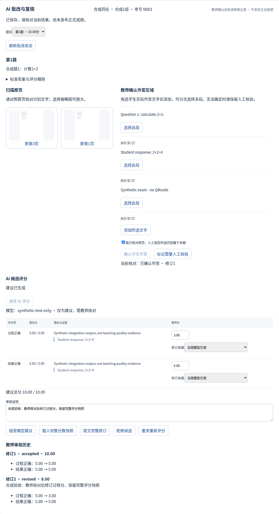
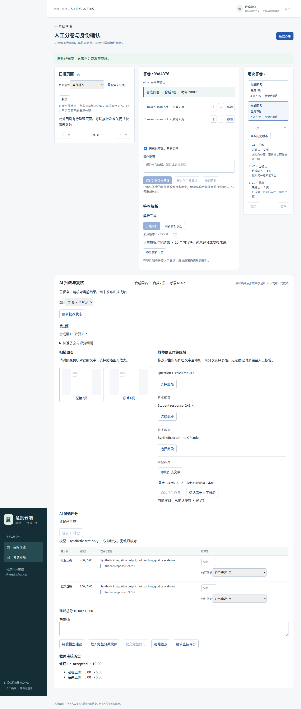

# 考试 AI 批改 MVP 验收

日期：2026-10-24。全部输入为合成资料，无真实学生数据、收费 API、模型下载或开发数据库升级。此记录区分解析成功、评分工程闭环和实际模型评分通过，不能互相替代。

## 环境与复现

Python 3.12、uv.lock、PostgreSQL 16.14、私有 S3 兼容测试桶、真实 FastAPI、签名 OIDC Code+PKCE/JWT 和 Chromium。只使用任务所有的隔离容器，测试库 `_test` 后缀，应用开发库与测试库明确不同；不改用户 `.env`。

MinerU 4.0.10 Basic/ONNX 使用已有隔离运行环境和本地缓存，设置 `MINERU_MODEL_SOURCE=local`，不下载模型。测试 Worker 使用原 MinerU 执行器与受保护解析通道。

```bash
uv sync --locked
uv run ruff check .
uv run pytest -q tests/unit
uv run python scripts/check_migration_structure.py
# 以下还需显式独立 TEST_DATABASE_URL 与私有测试 S3 配置：
uv run pytest -q tests/integration/test_exam_grading.py -m 'not mineru_e2e'
RUN_WORKBENCH_E2E=1 RUN_EXAM_MINERU_BROWSER=1 RUN_EXAM_GRADING_BROWSER=1 \
  uv run pytest -q tests/integration/test_teacher_workbench_browser.py
# 单独真实本地模型验收（已缓存模型，失败仍必须如实保留）：
MINERU_E2E=1 RUN_EXAM_OLLAMA=1 \
  uv run pytest -q tests/integration/test_exam_grading.py -m mineru_e2e
```

MinerU executable/home、测试存储和模型运行环境须由操作者明确配置；命令不是一键安装或自动启动模型。最后一项本轮实际失败，不属于默认 CI。

## A：确定性业务闭环

测试数据：两班、四个名单学生，其中两名同名，单场次共享锁定 PaperVersion，完整冻结名单。四页无二维码英文栅格扫描 PDF 顺序 A2/B1/A1/B2，题干和真实快照题目统一为计算 2+2，教师答案为 4，两个 Criterion 各 5 分。

浏览器实际执行上传、预览、下载、选择原第 3/1 页、人工调序、确认 N001/合成1班、真实 MinerU、准备受保护题目工作区、对照原页选择实际学生文字、明确人工归属、确认作答、排队、Worker 消费、查看候选、接受 10 分、完整修订为 3+5=8 并查看原 5+5 历史。

N002/合成2班先缺页，补原第 4 页产生新版本并重新核实身份，真实 MinerU 解析第 2/4 页，再独立确认作答、评分和接受。两份工作区不串学生、页序或审核记录。

**候选来源明确为 `synthetic-test-only` 测试 Provider**，只验证现有严格输入/输出协议、真实数据库/S3、队列和教师操作，不证明模型能正确评分。其响应原文也明确标记 Synthetic，不存在生产回退入口。





截图是实际浏览器，不是设计稿；清晰英文合成页不代表中文手写识别、复杂题型或真实教学质量验收。

## B：真实本地 Ollama 结果

使用本机已有 `qwen3.5:9b-q4_K_M`，loopback Ollama、Thinking disabled、4096 输出 Token、120 秒请求超时、零自动重试。没有切换云端，没有以重试直到正确的方式选择成功样本。

实际两次请求均 HTTP 成功且返回可解析 JSON，但**有效真实模型候选为 0/2，真实 AI 评分成功验收尚未通过**：

- 第一次仅选择真实识别的结果文字 `4`；严格校验返回 `model_total_mismatch`，不登记有效 Proposal。该次未完整保存 usage，不能补算或编造 Token。
- 第二次选择真实识别的完整 `2+2=4` 文字；回复中的 Quote 与确切学生片段不符，返回 `evidence_quote_mismatch`。响应同时存在总分 5 与两个 5 分逐项和 10 不一致，但首个实际拒绝码是引用不一致，不能把它误报为来源解析失败。
- 第二次真实响应模型 ID `qwen3.5:9b-q4_K_M`，prompt 720 Token、completion 319 Token、模型耗时 6731 ms。无收费 API 费用；本地计算成本未估算。
- 对应 opt-in pytest 因期待可用候选而失败；没有削弱断言、修补模型 Quote、改分、覆盖旧评测数据或将失败改报成功。

这证明本地服务可达和严格拒绝有效，不证明教学评分正确。下一轮应先对明确配置的模型验证精确 Quote/总分合同与质量；不应先放宽正分证据门禁。

## 自动化结果

- 后端纯单元 **662 passed**；Ruff、静态结构、Compose、差异空白通过。25 个迁移、64 张映射表，唯一 Head `b14c52b3f014`。
- 新评分真实 PG/S3 专项最终 **21 passed，1 deselected**（116.82 秒），另补存储故障 **2 passed**。加最终跨教师审核撤权竞态 1 项，共 24 个不同新增用例，真实模型 opt-in 独立排除。
- 受影响旧 GradeInput、GradeProposal、GradeReview/HTTP、AnswerReview HTTP、SourceReadiness、考试解析、安全回归初跑 **135 passed，2 failed，2 deselected**。两项失败分别为新迁移 Head 断言和历史图的新表登记遗漏；更新测试清单，保留旧图行数与摘要断言后，两项独立复跑通过。该组最终 137 个不同回归用例通过，不将重复运行累加成新用例。
- 上述两个迁移复跑加两个新增 S3 故障场景的最终命令 **4 passed**（41.42 秒），与前述统计重叠。
- 前端锁定安装、TypeScript、ESLint、生产构建通过，Vitest **53 passed**；OpenAPI 重生成与 TypeScript 合同一致。Fast CI 只执行静态/纯单元和前端合同检查，不访问收费模型。
- 最终真实浏览器 pytest 包装 **1 passed**（54.63 秒），内部 **3 个 Chromium 场景 passed**（46.6 秒），第三场景包含两份真实 MinerU 答卷及两条 Synthetic 评分链；不把包装器和内部场景相加。
- 独立迁移库 upgrade/check/downgrade 至 b14b/re-upgrade/check 通过，最终 Alembic check 无模型差异；有工作区事实时降级拒绝，原行与 Head 保留。历史 legacy 图往返摘要不变。

## 安全与故障证据

`test_exam_grading.py` 使用真实数据库和私有对象存储，只有模型响应为显式 Synthetic：

- 没有教师确认、uncertain、源变更不生成 ready 输入或零分。
- 引用错误、正分无 Quote、总分错误、超分、超时安全失败；模型弃权无分数。
- 跨教师审核在详情读取后、提交前撤销原评分申请人的 Grant，最终拒绝写审核；复现旧提交函数返回 200，新实现返回 404。该隔离回归及原正向审核均通过。
- 同请求并发、不同正文冲突、审核 expected_revision、完整两 Criterion 多次快照与 supersedes 保留，直接 SQL 改历史失败。
- 仅旧 admin 或无该场次 Grant 不能读取；跨 PaperQuestionMapping 直接 SQL 拼接与删除工作区失败；旧 GradeInput CLI 和对齐服务不能消费新考试来源。
- 模型执行期间人工来源修订、名单更正、卷版退役、撤权和停用阻断候选登记。
- 两 Worker 只领取一次；错误 Token、过期租约、迟到模型完成不产生成功索引，过期任务不自动重新调用模型。
- 审计失败回滚候选和成功状态；输入或 Proposal 上传失败无虚假成功；候选/教师审核 COMMIT 已成功但确认丢失可回读并按原请求恢复，既不重复登记也不删除已引用文件。
- 私有对象 SHA/大小、Canonical/Alignment/GradeInput/Proposal 协议校验仍有效，公开 JSON 无对象 Key、凭据或自由来源覆盖。

## 保护范围及限制

README、现有已应用迁移、100 个 Git 跟踪 data 文件及既有评测预测未更改；PR31/42、视觉/备份分支和 stash 保留。用户所指其他受保护材料没有被写入；不将上述 100 个跟踪文件计数冒充全部 101 项材料的独立清单证明。

- 真实本地模型尚未生成通过门禁的候选；Synthetic 工程成功不能替代此项。新 PR 应保持 Draft 独立审查。
- 单进程小批工作区，历史只投影最新 20 条、最多 100 题及有界文字/响应；不声称全校并发或所有题型容量。
- 来源与原申请人失效后默认拒绝，历史不改写；目前旧候选的专用历史浏览需要后续设计，不通过放开 legacy 入口补齐。
- 存储成功但 DB 未登记的对象保留待对账；没有自动垃圾回收。原解析物化取消的文件句柄问题独立跟踪 Issue #51，未宣称已修复。
- `regrading_required` 是教师审核事实；重评分须显式重新确认作答创建新复核版本，首版不自动重试。
- 来源是否满足复杂题目必要材料仍受既有可信元数据边界限制；未增加 TeacherRequirement 模型、图像评分、双评、正式成绩或发布接口。

下一步只需围绕本 Draft PR 完成独立安全审查及真实模型协议/教学质量验收，不需要重写 Provider、评分协议、旧审核规则或扩大成绩系统。
