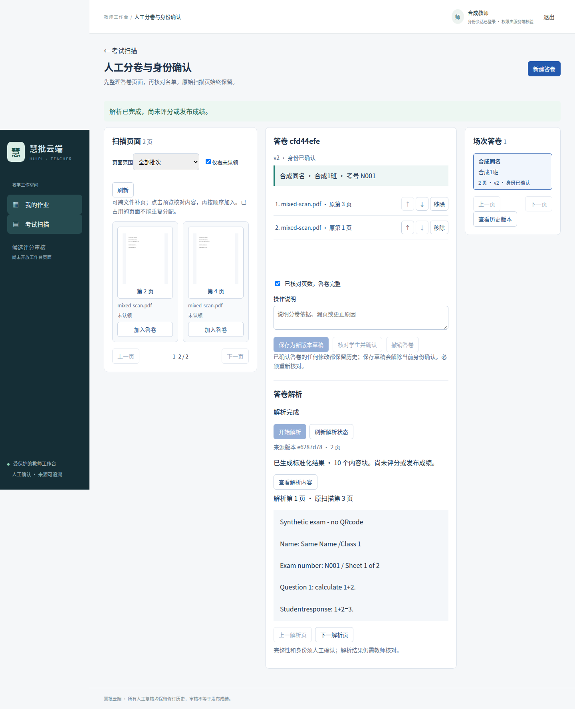

# 受保护考试解析验收

日期：2026-10-23。输入全部为合成材料，不包含真实学生资料；没有收费API、模型下载或开发库升级。

## 可复现环境

- Python 3.12、uv锁定依赖，独立PostgreSQL 16.14，私有S3兼容测试存储；每测试独立对象前缀，数据库名称以`_test`结尾且不同于开发库。
- 真实MinerU 4.0.10 Basic/ONNX，使用已有`mineru-4.0.10`隔离环境和`mineru-home`缓存；启动校验指定`MINERU_MODEL_SOURCE=local`，模型verify正常。未更新模型权重。
- Chromium实际连接FastAPI、Vue和隔离OIDC Code+PKCE服务，不使用Mock业务成功。

## 分层证据

纯单元检查协议、固定Scope和摘要；真实PG/S3专项覆盖独立队列、物化页序、私有对象、租约及事务；测试执行器明确输出`synthetic_test_executor=true`，不把这些测试计为真实OCR成功。

真实MinerU专项另行运行：两页经已确认答卷版本物化，再由原MinerU执行器解析、规范化、原子登记产物并通过考试专用页接口回读；完整输入大小/SHA和原页映射保留。

真实浏览器场景：两班四学生（两人同名），共享锁卷和冻结名单，四页栅格PDF为A2/B1/A1/B2；操作员选择原第3、1页组成同名学生N001答卷，确认卷别，发起独立Job。真实Worker/MinerU输出2页、10个Canonical内容块，浏览器显示原第3页对应解析第1页及实际识别文本。另一同名学生N002、缺页状态、补页新版本和历史仍通过原流程验收。



该样例为清晰英文合成扫描页，不能推断中文手写、复杂公式或真实教学评分准确率。成功只证明本次受保护来源到解析/Canonical的业务闭环。

## 命令与默认隔离

使用独立测试配置，不复制或改写开发.env：

```text
uv run pytest -q tests/unit
uv run pytest -q tests/integration/test_exam_parsing.py -m 'not mineru_e2e'
MINERU_E2E=1 MINERU_EXECUTABLE=/已有环境/bin/mineru-kit MINERU_HOME=/已有模型缓存 uv run pytest -q tests/integration/test_exam_parsing.py -m mineru_e2e
RUN_WORKBENCH_E2E=1 RUN_EXAM_MINERU_BROWSER=1 MINERU_EXECUTABLE=/已有环境/bin/mineru-kit MINERU_HOME=/已有模型缓存 uv run pytest -q tests/integration/test_teacher_workbench_browser.py
```

这些命令还需要明确的独立TEST_DATABASE_URL和私有测试存储配置。默认Fast CI只做Ruff、纯单元、静态迁移及前端合同，不连接模型或收费服务。

## 安全与故障断言

- 旧Worker不能领取已物化的兼容Task；旧Submission/File/Canonical路径404，旧Assignment列表不显示考试载体。
- 未确认、incomplete、过期名单及错误Manifest不能建立Job；同版本重复点击唯一Job。
- 发起权限与读取权限分离；旧admin/JWT role不授权，跨场次Job和页正文拒绝。
- 原页序通过真实PDF读取比对；原件和预览校验长度/SHA，物化后篡改原预览也不能执行解析。
- 答卷/名单更正、授权撤销、卷版退役使运行Job失效，取消执行，不能登记新成功产物。
- 两个Worker只有一个领取；错误token/过期租约不登记结果；Link不可改写/删除。
- S3失败无部分Submission/Link；物化或完成审计失败整体回滚，ParsedArtifact/Canonical不会半提交。
- 请求及结果COMMIT已成功但丢确认后，唯一Job、引用对象及结果可回读；不执行猜测性对象删除。
- 新增Job事实时拒绝降级，历史版本、名单及原卷保留。

## 迁移与兼容

迁移`b14b41a2e903`仅增加三表/固定权限角色。空切片真实PG执行upgrade/check/downgrade至b14a/re-upgrade/check；有新事实时拒绝破坏性降级。相关试卷/考试/扫描/安全迁移测试继续比较既有业务图行数和摘要，不通过清空开发数据验收。

## 限制

- 单API进程、单考试Worker串行的小批MVP，未验收1600页容量；拼接子进程的资源上限不等于MinerU RSS硬上限。
- 授权撤销阻断后续操作，不能收回已经返回的合法内容；Manifest、结果状态和引用都不是永久授权。
- 孤立输入/产物需要延迟对账清理，未实现自动GC；来源失效或尝试耗尽须核对并建立新答卷版本后重发。
- Canonical页面只显示文本结构，素材预览和完整教材公式渲染未新增。
- 后续考试AnswerAlignment/GradeInput仍需要受控任务入口，不能直接放开旧评分服务；未执行评分、自动零分、缺考或正式成绩发布。
- #48历史版本逐版本延迟校验、#49分卷刷新同步仍独立跟踪；本轮修复#47的Manifest摘要消费门禁。#44/#45扫描已知问题未被声称解决。

## 本地执行结果

- 受影响真实PG/S3组合：**213 passed，2 deselected**，562.92秒；随后针对状态约束、共享请求审计与能力标记补充复核，最终专项及Manifest正向真实PG/S3回归均通过；两个显式模型标记由本次组合排除。覆盖扫描、名单、考试、锁卷、安全、旧Worker及Canonical。首次发现旧安全迁移测试遗漏新表清单，修正新表登记后整组通过；旧图行数/摘要断言保留。
- 最终桥接专项：**26 passed，1 deselected**，98.05秒；包含后续补充的多操作者共享Job审计、版本更正、数据库状态形状等，和上述组合重叠，不相加计算独立用例。
- 纯单元：**654 passed**；前端Vitest：**50 passed**。锁定依赖安装、Ruff、TypeScript、ESLint、生产构建、Prettier、Compose配置和差异空白检查通过。
- 真实MinerU专项：**1 passed，26 deselected**，10.83秒；通过真实独立CLI Worker进程领取任务、调用MinerU、回读Canonical并SIGTERM正常退出，默认仍不调用模型。
- 最终真实浏览器：**1个pytest包装场景通过**，34.85秒，内部**3个Chromium场景通过**；第三个场景使用真实MinerU，不是SyntheticExecutor。首次和复测均保留实际后端状态轮询、源页映射与内容断言。
- Alembic：独立真实库upgrade/check/downgrade/re-upgrade/check通过；唯一Head `b14b41a2e903`，24个迁移、61张映射表。有新Job时降级拒绝且行及Head保全；旧业务摘要测试通过。

真实模型场景与合成执行器场景分开统计，不相加冒充更多真实OCR验收。GitHub Fast CI状态以PR最终HEAD为准。
