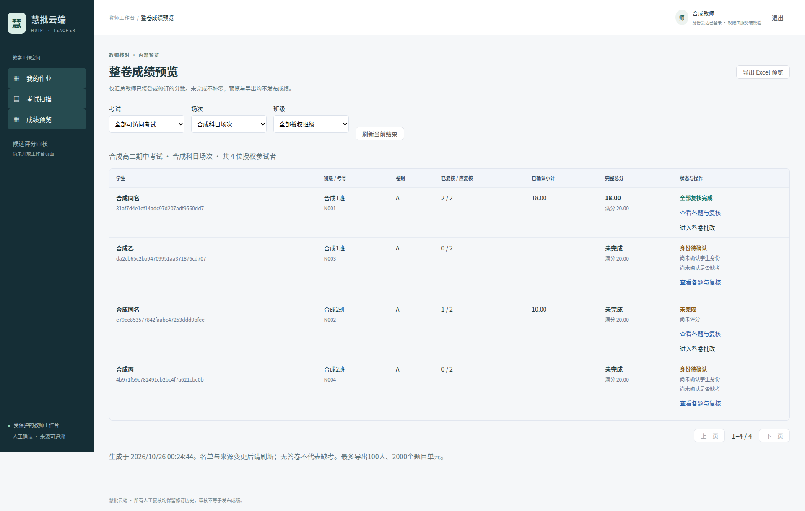
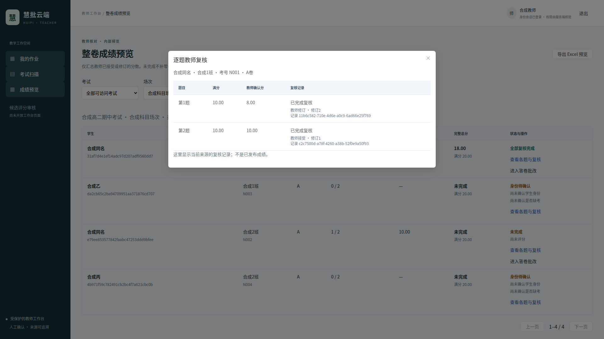

# 整卷成绩预览与班级授权验收

交付整理：2026-10-26。实现基线为 `dd5e83e196055d47835f027caf698556c2d2c7a4`。
详细合同见[开发指南](../development/exam-results-preview.md)，本记录不代表正式成绩发布或教学准确率认证。

## PR #54 独立审查及合并

对精确 HEAD `c4dd9d32a0219a71c39b484618c06904a331a50a` 在独立上下文手工审查，结论 APPROVE，无 P0/P1。
确认默认严格偏移 v4 不变，新策略显式启用，唯一原文定位不修补引用，原 Rubric/Decimal/总分校验仍执行，
回执是私有对象，S3成功后事务失败可能留待对账对象，未知COMMIT不盲删。

PR #54 已 Squash Merge 为上述 main 基线，[main Fast CI](https://github.com/hvqo/huipi-cloud/actions/runs/40176013203)成功。
非阻塞 P2：`scripts/validate_production_quote_selection.py` 的验收 Capture 包装在底层 Provider 抛截断异常前未记录原始响应/usage；
生产 `_call_and_validate` 与 response_audit 已覆盖该失败。应在独立验收工具加固切片修复，不宣称本轮已解决。
通分案例高估3分继续保留在[真实评分验收](production-quote-selection.md)，没有改标签、预测或绕过教师复核。

## 实现范围

- 新增 `exam_results` 只读服务与三个受保护 GET：可访问场次、分页预览、xlsx导出。
- 新增一个班级限制表 `exam_result_class_access`，迁移 `b15a60c4f015`；不持久化成绩总分。
- 用户明确要求教师仅看授权班级。限制绑定同一个完整真实 Grant，不能拼接、伪造 JWT role 或使用旧 admin。
  读取与导出权限分开，受控JWT CLI提供登记与撤销，安全审计同事务。
- Vue `/exam-results` 及扫描工作台入口，按考试/场次/班级查看，逐题当前复核记录、答卷深链、受保护下载。
- accepted/revised 才计分；完整题集全部有效复核才显示整卷总分，否则为小计或空白；不推断缺考、不补零。
- 真实锁定PaperVersion/Rubric与Mapping ID定义题集，A/B卷同题号不同映射不合并。选做规则未实现，不宣称支持选做计分。

## 真实 PostgreSQL / 私有 S3

使用任务专属 PostgreSQL 16、私有测试 S3、真实签名 OIDC/JWT 与 FastAPI。模型仅使用明确的 Synthetic 测试响应。
不连接或升级用户开发数据库，不用 SQLite 或 Mock 替代数据库/存储。

最终受影响回归：**71 passed / 2 skipped**。包括19项新预览专项，以及原考试评分和资源安全模块。
随后新增混合查看/导出班级限制专项，全部20项预览专项重跑通过；其中19项与上一轮重叠，不重复计数。
两项跳过是显式 opt-in 的真实模型验收，本轮不发起收费调用。结果日志 `pg-regression.log`。

新专项覆盖：

- 完成卷18分与部分卷10分小计；无复核、拒绝、重评分、弃权都无完整总分，未复核小计也不是0。
- 两班、四个稳定学生身份、同名学生独立；当前名单和班级服务端过滤，外班/跨场次/旧admin/未授权身份/未登录拒绝。
- 班级授权、父Grant撤销及账号停用后立即拒绝新的预览与下载；无导出标志的读者不能导出；混合权限的整场次导出拒绝，不会静默省略未授权班级。
- 不完整Grant不能拼接；普通主体不能自行登记；授权审计失败整体回滚，直接SQL改写班级限制历史被触发器拒绝。
- 最新拒绝覆盖旧接受；教师作答确认变化使旧分失效；Canonical字节篡改拒绝返回学生表。
- A/B卷具有独立题目集合；未知身份不自动选卷；同题号的不同Mapping在Excel中为不同列。
- 数据库故障安全503；人数/分页上限拒绝，无半份Excel或学生表泄露。
- 并发复核期间，导出持有一致性场次锁，实际观察到PG锁等待：导出得到完整旧20分，随后新读取为18分，没有混合。

既有评分回归继续覆盖来源/名单/卷版变更、原评分申请人撤权、双Worker、过期租约、审计回滚、未知COMMIT、
完整Criterion修订历史、legacy隔离及私有响应回执。没有为适配预览削弱这些断言。

## 数据迁移与历史保全

唯一 Alembic Head `b15a60c4f015`，26个迁移、65张映射表；静态结构检查通过。
仅新增迁移，既有迁移不改。在独立测试库执行 upgrade、check、降级前一版、重新upgrade及check。

新班级授权事实存在时降级被明确拒绝。测试专用清空新切片表后执行往返；27张既有业务表逐表计数及排序JSON SHA一致，
其中真实存在考试、名单、原始扫描、解析、作答确认、Proposal和GradeReview记录，不能用空表声称保全。
旧资源安全迁移专项又独立创建临时库从早期基线往返并检查legacy摘要；拒绝破坏性降级保持原断言。
测试中的TRUNCATE不是生产回滚方案；没有升级用户开发数据库。

证据：`migration-history.json` 保存27张表的往返摘要；`tests/integration/test_exam_results.py` 提供可重跑逻辑。

## Chromium与Excel实际验收

Chromium **3个场景通过**，Python真实服务驱动器1项通过。现有OIDC/Unicode/幂等/冲突、文件预览与新建作业场景保留。
新场景在真实扫描、人工分卷、同名身份确认、缓存MinerU解析和Synthetic候选评分后：

1. 第一位学生两题，接受后教师将一题完整修订为8分，另一题10分，总分18。
2. 另一班同名学生只完成一题10分，完整总分为空，另两名无答卷学生保持身份待确认。
3. 打开逐题复核对话框，检查8分、10分和修订2；班级筛选只返回本班两人，再返回全部明确授权班级。
4. 实际下载xlsx；独立 `openpyxl` 读取验证三张表、四名学生、15列、完整18、小计10且总分空白。
   无公式、无超链接；学号/考号是文本，真实0与空白由单测分别核验，工作表保护生效。

来源版本及摘要在额外工作表中，不使用公开S3链接；导出生成时重新校验并不复用前端表格。

本轮确实执行缓存 MinerU 4.0.10 Basic/ONNX，本轮浏览器评分是明确 Synthetic，不冒充真实DeepSeek。
真实「MinerU→DeepSeek Flash→教师审核」复用PR #54冻结的[业务链路证据](production-quote-selection.md#真实解析云端评分教师审核闭环)，
该记录包含实际第13次调用、954/213 Token及教师审核HTTP结果。本轮新增预览模块无模型调用，不产生新增API费用。
英文合成扫描不能证明中文手写准确率，自动驱动的合成教师身份不是合格教师双评。

## 工程检查与调试记录

- 后端纯单元697项通过；Ruff、静态迁移、Compose和diff空白检查通过。
- 前端锁定依赖安装、类型、Lint、56项Vitest和生产构建通过，生成OpenAPI类型已同步。
- 浏览器调试发现并修正新模板多语句事件语法；随后修正测试中下拉框定位及整页跳转丢失内存登录态的问题，
  最终通过真实RouterLink导航，没有降低登录、分数或来源断言。保留首跑失败日志，不删失败记录。
- 两张截图在实际浏览器检查；逐题弹窗截图关闭动画后重新生成，避免将动画中途的空遮罩当成交付图。
- README未修改；没有修改用户.env、旧冻结数据、已应用迁移、PR31/42、视觉分支、备份或stash。

本机证据目录：`/home/amber/.cache/huipi-cloud/exam-results-preview-20261025/`；保留早期目录日期便于追溯。
包括最终数据库日志、迁移摘要、浏览器结果、实际xlsx及其独立读取摘要。私有测试容器凭据不进入Git。

## 剩余限制

- 新班级限制只覆盖预览与导出，既有整场次批改/名单授权仍按原合同；部署必须审查原Grant，不能宣称完成全系统班级RBAC。
- 小批量读取会核验私有来源并串行化场次，60秒预算、100人导出、128MiB来源预算不是全校吞吐承诺。
- 尚无可信到考/缺考、选做、成绩审批/发布版本、正式冻结或撤回、排名、学生成绩访问。
- 教学语义风险及未经教师独立复核的合成参考标签继续保留。候选、字符匹配、内部预览均不等于正式成绩。
