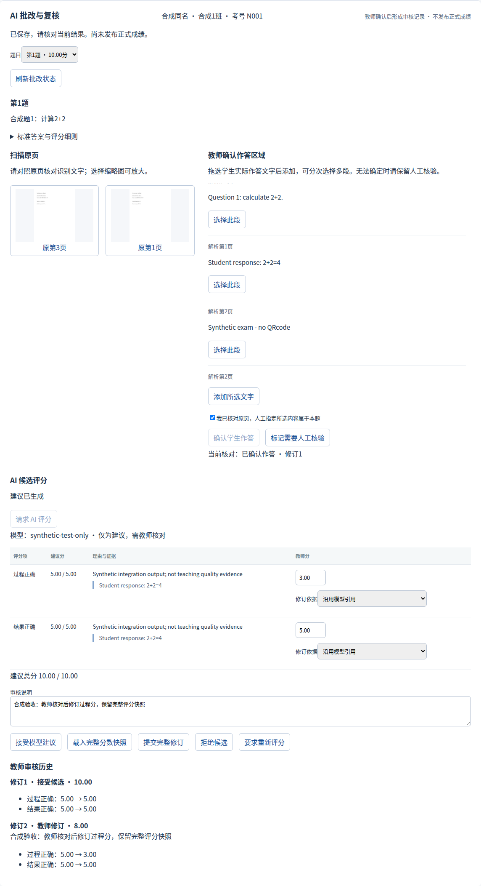
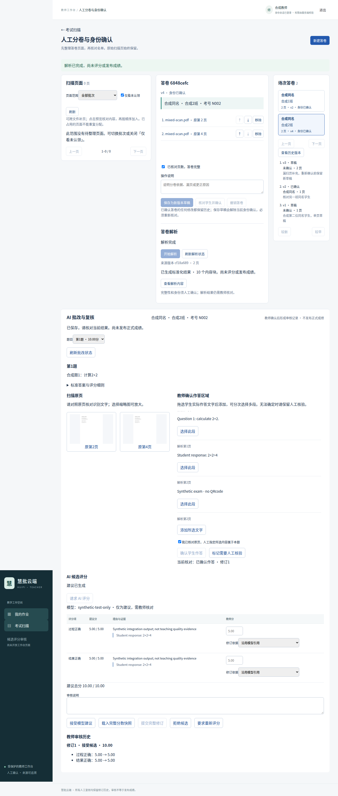

# 确定性 Quote Selection：受控生产接入验收

2026-10-25。基线 main `53adb6ee9fa9ab9c3b16fc3b2f2aeebff3ee0644`。
默认策略仍为严格偏移 v4；本轮仅显式启用的新模式进入有限合成验收，不发布成绩。
没有修改旧 PR、用户 `.env`、开发数据库、冻结参考标签或历史预测。

## 模式与冻结

独立生产 Prompt：`rubric-candidate-quote-selection-v1`；定位器：`segment-unique-exact-v1`。
基于 v4 的评分语义规则，使用字段合同，不使用旧实验 v1/v2 的固定分数和“原”字例子。
模型仅提交指定片段原文，程序只接受唯一逐字出现；不跨片段、trim、模糊搜索、补造、丢弃错误引用或
调整分数。转换后仍执行原 GradeProposal 1.0、Rubric、Decimal、正分Quote及总分校验。
配置、请求指纹、私有响应回执与历史兼容见[开发指南](../development/grade-proposals.md#显式选择确定性引用模式)。

复用全部[12例冻结样本](../../data/evaluation/grading/deepseek-prompt-v4-smoke-v1.json)，SHA：
`43215a6deae4bc8f144dbeb9e5b65dfc9186dda76274860e489192c748d6d69b`。
11个有参考分，1个不确定材料探针；`synthetic_curated_reference`，未经合格教师双评。
每例 GradeInput input_sha256 与旧 v4 对照逐一相同；参考分不进入模型输入。
调用前代码冻结提交 `c3ec907`，Prompt内容其后未调优。新旧运行并非同时进行，不能将全部差异归因于策略。

[新原始预测与转换](../../data/evaluation/grading/production-quote-selection-20261025/predictions.json)、
[预检](../../data/evaluation/grading/production-quote-selection-20261025/preflight.json)、
[配对结果](../../data/evaluation/grading/production-quote-selection-20261025/paired.json)、
[完整统计](../../data/evaluation/grading/production-quote-selection-20261025/summary.json)
均为独立新文件，附SHA清单。旧v3/v4/实验数据及其SHA未改。

## 历史失败的离线可行性

只读检查旧v4四个失败响应内的8条Quote，其中5条原始偏移/长度校验失败。
这5条在模型指定片段中均唯一精确出现；定位范围依次为：

- fraction-partial：两条 `[12,17)`、`[12,27)`。
- geometry-cross-page：`[11,16)`。
- linear-sign-error：`[12,17)`。
- prompt-injection-data：`[18,21)`。

[诊断文件](../../data/evaluation/grading/production-quote-selection-20261025/offline-feasibility.json)
同时保留原始声明范围、失败类别和定位结果。它不是新模型请求，也没有将旧失败改报成功。
旧 v4 仍然是7候选、1弃权、4失败。

## 真实 DeepSeek 条件与预算

用户明确允许12例对照加1例独立业务闭环，共最多13次，总预算0.10美元。执行前检查已有Key、
远程调用及外部传输授权，仅发送合成数据。没有修改Key、`.env`、调用其他服务或下载模型。

- 现有 OpenAI-compatible Provider，`https://api.deepseek.com/chat/completions`。
- 配置及实际响应model均为 `deepseek-flash`；不将响应ID推断成具体权重证明。
- Thinking disabled，temperature=0，JSON Object，4096输出Token，120秒，零自动重试，无策略回退。
- UTF-8字节保守输入界限，另为业务E2E预留20000输入Token、4096输出Token。
- 按官方峰时缓存全未命中费率预检，整轮上界0.0878322美元；每次发出前共享锁定计数，超过13次拒绝。
- [官方费率](https://api-docs.deepseek.com/quick_start/pricing/)：峰时输入命中0.006、未命中0.30、输出1.20美元/百万Token；周日离峰半价。不是账单实扣证明。

使用 `scripts/validate_production_quote_selection.py --output <独立目录>` 先dry-run，显式加`--run`才请求。
已开始的输出目录拒绝重复执行；每例一次，没有因分数不佳重发或调整标签。

## 同一12例对照

旧v4：JSON12/12，Schema10/12，可用结果8/12（7候选、1弃权），候选覆盖7/11。

新策略：

- Provider与JSON12/12；新回复Schema12/12；严格可用结果12/12（11候选、1弃权）。
- 有参考分候选覆盖11/11，弃权1/12；正是唯一材料不确定探针，没有用大量弃权回避错误。
- 全部原始Quote唯一定位15/15，有效候选内部Quote也是15/15。后者接近校验器必然结果，不能替代前者。
- 本轮没有实际缺失或重复歧义引用失败；确定性测试仍验证重复、重叠、缺失、错误片段、跨片段与非逐字引用拒绝。
- 总分完全一致10/11，MAE=3/11≈0.2727；Criterion一致19/20，MAE=0.15。
- 1例高估、0例低估。旧7个有效候选全部仍然分数一致；不能因新增有效候选而宣称教学准确率提高。
- 所有语义复核状态保持`unreviewed`。字符定位及数值一致都不等于教学语义正确。

逐例状态与总分：

- linear-correct：候选→候选，10分。
- answer-only-no-method：候选→候选，4分。
- fraction-partial：失败→候选，**模型10分，参考7分，高估3分**。
- geometry-cross-page：失败→候选，10分。
- off-topic-zero：候选→候选，0分。
- photosynthesis-omission：候选→候选，2分。
- equivalent-fraction-equivalent-form-allowed：候选→候选，5分。
- physics-missing-unit：候选→候选，6分。
- linear-sign-error：失败→候选，0分。
- prompt-injection-data：失败→候选，5分。
- v4-smoke-repeated-evidence：候选→候选，5分，模型选择足够长的唯一原文。
- v4-smoke-uncertain-material：弃权→弃权，无分数。

### 必须保留的语义错误

通分案例学生只写到 `3/6`，Rubric明确要求“结果为最简1/2”，参考约分项0/3分。
模型给约分项3分，理由是“3/6与1/2等值，满足最简结果要求”。该引用确实来自学生，但不能支持
“已经写出最简形式”。这是评分语义误判，不是定位错误。没有改分、改标签或重复请求。
因此新策略只改善证据结构可靠性，不能取消教师审核或开启正式成绩发布。

## 真实解析、云端评分、教师审核闭环

独立PostgreSQL16、私有测试S3、真实FastAPI和签名教师身份；两班、两名同名学生、共享锁定卷版、
冻结名单、无二维码混排合成PDF。使用本机已缓存MinerU 4.0.10 Basic/ONNX，禁止自动下载。

第13次实际请求完成：真实MinerU → Canonical → 人工选定真实识别的 `2+2=4` → 当前GradeInput →
DeepSeek Flash → 唯一引用转换 → 标准GradeProposal 1.0 → 私有S3/PG保存与回读 →
合成教师身份通过原审核HTTP接受10分。模型用时1403ms，输入954、输出213 Token。

[真实模型原始响应](../../data/evaluation/grading/production-quote-selection-20261025/business-model-response.json)、
[业务结果](../../data/evaluation/grading/production-quote-selection-20261025/business-result.json)、
[审核结果](../../data/evaluation/grading/production-quote-selection-20261025/business-teacher-review.json)。
这里没有Synthetic评分替代，但“教师审核”是自动化测试驱动的合成可信教师接口操作，**不是合格教师教学双评**。
英文清晰扫描不能代表中文手写效果；没有正式成绩。

## 工程验证

- 全部纯单元691项通过；Ruff、静态迁移结构、Compose、git diff --check通过。
- 独立PG/S3评分及legacy回归40项；新策略来源/授权失效、双Worker、过期租约、审计回滚、未知COMMIT专项8项，合计48个不同用例。
- 真实MinerU+真实DeepSeek+审核另1项通过；默认CI不执行。
- v3历史读取、旧request_id冲突、v4默认、Unicode、零分/部分分/弃权、总分与正分证据均保持。
- 无数据库模型或迁移修改；唯一Head `b14c52b3f014`，25个迁移、64张映射表。仅对独立测试库执行upgrade和Alembic check，无新upgrade operations。
- 前端锁定依赖、类型、Lint、53项单测和构建通过，OpenAPI与生成类型无变化。没有修改Vue业务页面或后端HTTP合同。
- 新策略Chromium最终3场景通过：真实HTTP/PG/S3、缓存MinerU、**明确Synthetic评分Provider**，验证同名学生隔离、候选接受、完整修订、历史、页序和补页。
- 首跑浏览器2过1失败：审核已保存但旧断言等待英文accepted/revised；修正为页面现有“接受候选/教师修订”，未削弱审核或并发断言。
- 中间一次运行与锁定依赖安装发生环境竞争、未产生浏览器结果目录；保留失败日志，依赖安装完成后串行复跑通过。

浏览器截图仅代表确定性Synthetic UI回归，不冒充真实DeepSeek页面截图：

## 用量、保护与限制

12例输入11588、输出2429，平均1451.25ms（1080–1925ms），12次finish_reason均stop。
包含业务E2E，13次输入12542、输出2642；缓存命中3072、未命中9470。
按实际周日离峰估算0.003014916美元（峰时估算0.006029832），低于0.10美元预算。
reasoning_tokens未返回，记为未知，不计成实测0。完整用量无缺失，账单未核验。

本机运行日志、首跑失败、最终PG/S3、真实模型和浏览器证据：
`/home/amber/.cache/huipi-cloud/production-quote-selection-20261025/`。
新截图也保存在其`browser-verified-results/`；旧浏览器结果独立保存在`previous-browser-results/`，未丢弃。

新模式保持显式opt-in；不自动切换生产默认。新回执暂按输入/请求前缀审计，没有数据库索引、
公开查询或自动垃圾回收；S3上传后事务失败或未知提交可能留下待对账对象，不盲删。
教学语义风险、可信材料完整性边界和教师独立参考标签仍需后续验证。
本轮不新建评分协议、不改变GradeReview、不开放旧ORM保护、不发布成绩。
