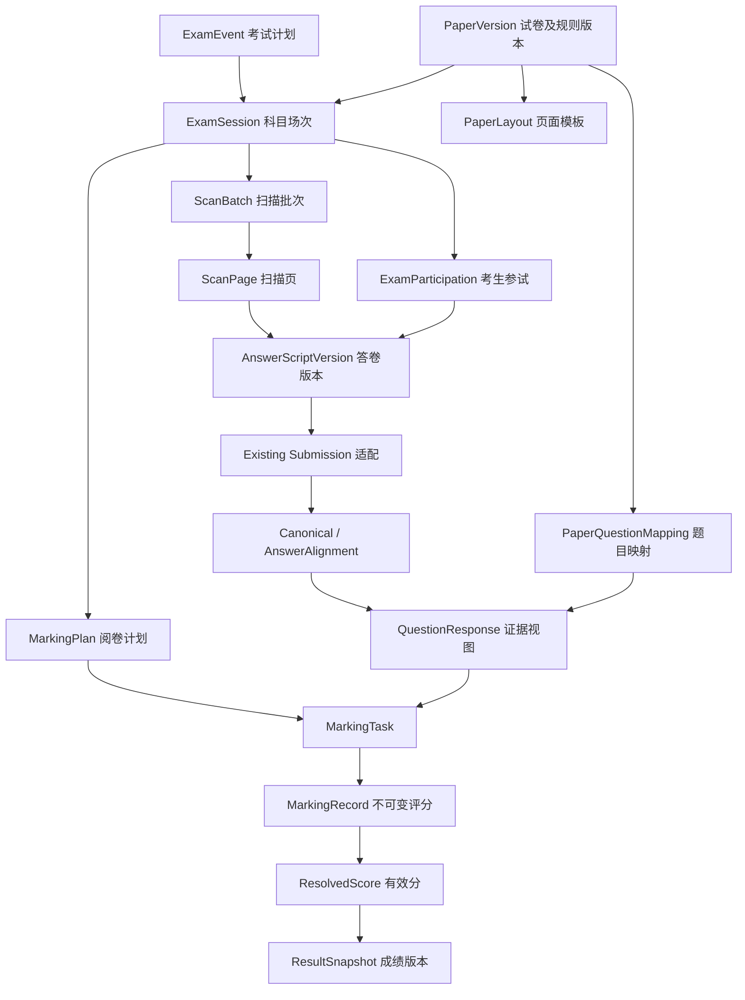

# 慧批云端考试阅卷业务需求与边界设计

> **文档性质**：产品需求基线 + 业务边界 + 领域模型建议 + 技术改造约束 + 验收标准  
> **面向系统**：慧批云端（huipi-cloud）  
> **适用范围**：**一所普通高中**的日常作业、班级测验、年级统一考试及校内集中阅卷  
> **版本**：1.0（讨论基线，不代表已审批或已实现）  
> **整理日期**：2026-10-18  
> **下一步用途**：供新的开发会话进行仓库审计、需求拆分、架构评审、任务排期与逐阶段实现

---

## 0. 执行摘要：先读这一节

### 0.1 为什么需要重新设计

慧批云端最初以“教师创建作业—上传单份学生提交—解析—来源对齐—候选评分—教师复核”为核心流程。它适用于普通作业，但不能直接覆盖一所高中真实的纸质考试场景：多个班共用一张试卷，统一扫描时卷子可能混合；扫描员未必是任课教师；批改可以按班、按整卷、跨班按题、混合分工、双评或仲裁；纸质答卷可能没有二维码，甚至没有完整身份信息；扫描或评分开始之后仍可能发现漏页、错卷、错人、补扫、补考等异常。

因此本次设计的重点**不是增加一个扫描仪上传按钮**，而是补齐“考试组织、试卷版本、参试身份、扫描分卷、题目证据、阅卷任务、有效成绩、授权发布”完整业务链路，同时尽量保留已完成的解析和人工复核成果。

### 0.2 七条不可妥协的设计原则

1. **范围限定为单所高中**：按单校设计，但支持年级、行政班、教学班、考场、备课组、教务与阅卷组；**不建设跨校、多租户、教育局平台**。
2. **试卷 ≠ 考试 ≠ 班级 ≠ 考生 ≠ 扫描批次 ≠ 阅卷任务**：这些概念分别建模，禁止把“谁教这个班”直接推导成“谁阅这张卷”。
3. **无需二维码也能工作，但不伪造确定性**：优先由考试/批次上下文确定试卷，再以固定印刷特征辅助校验；学生身份、分卷边界无法证明时必须人工确认。
4. **作业与考试共享底层能力，保留不同业务规则**：共用文件接入、存储、OCR/OMR、来源证据、候选评分；考务、阅卷调度与成绩发布单独设计。
5. **所有关键结果可追溯**：原件不可静默替换，分卷、模板、作答区域、评分标准、评分记录和成绩均需版本/来源链。
6. **机器建议不等于业务事实**：OCR/视觉匹配、OMR、AI 评分是带来源和不确定性的候选；只有符合配置的业务门禁才可继续；未经验证的 AI 结果不自动成为正式成绩。
7. **演进式重构而非推倒重来**：优先增加适配层与新领域模型，保护已有 `Assignment / Submission / ParsingTask / Canonical / AnswerAlignment / AnswerReview / GradeInput / GradeProposal` 合同和历史数据。

### 0.3 首个真实闭环（MVP）

教师创建或选择考试及原始试卷 → 扫描员选择考试后上传一个**无二维码、混合班级**的批次 PDF → 自动给出页组、模板、身份候选 → 人工修正与确认 → 正式生成按学生分离的答卷和现有 `Submission` → 解析/映射 → 按班或跨班按题分配阅卷任务 → 人工复核并保留来源 → 形成**未发布**的成绩预览。**首次交付不要求可信的自动手写评分，也不应直接开放正式成绩发布。**

---

## 1. 当前仓库现状与改造边界

> 本节根据 2026-10-18 对 `hvqo/huipi-cloud` 的 `main` 文档与 PR 状态的检查编写。后续执行时仍需以最新仓库实际代码和迁移为准，不得仅凭本文件假定功能已存在。

### 1.1 已有能力（可复用，不等于真实校内业务验收完成）

- **后端**：FastAPI、SQLAlchemy Async、PostgreSQL、Alembic、私有 S3 兼容对象存储；模块化单体。
- **现有作业**：`Assignment`、题目 `Question`、标准答案 `AnswerKey`、`Rubric`、发布校验；教师成员授权。
- **提交与解析**：PDF/JPG/PNG 单份提交；`Submission`、`ParsingTask`、独立 Worker、MinerU 4.x、Canonical Document、AnswerAlignment。
- **作答证据**：版本化人工复核、视觉建议、来源 SHA-256、来源指针、坐标和较严格的来源有效性检查。
- **评分**：GradeInput、基于 Rubric 的 AI 候选评分、人工接受/修订/拒绝/重新评分及不可变历史；**没有正式成绩发布链路**。
- **身份**：OIDC JWT 验证、教师及管理员映射、作业授权；真实学校 IdP 尚需部署验收。
- **任务基础**：PostgreSQL 任务轮询、租约、重试、心跳，不要求为新扫描功能立即引入 RabbitMQ、Celery 等第二套队列。
- **现有局限**：`student_ref` 只是模拟身份；没有完整学生、班级、参试名单与考务领域；没有可靠批次分卷、答题卡 OMR、跨班阅卷任务和正式成绩；当前对真实学生手写、真实考试负载的质量尚未充分验收。

### 1.2 前端现状

- 已有教师工作台基础与管理能力；前端 PR [#31](https://github.com/hvqo/huipi-cloud/pull/31) 在检查时为 **open / draft / 未合并**，其演示界面不是生产验收证据。
- 新前端业务页必须以真实后端 API 合同为准；不得以 Mock 演示数据冒充真实阅卷、扫描或成绩功能。
- 不得在不先审查 PR #31 与 `main` 差异的情况下，直接在旧基线上重做前端或盲目合并。

### 1.3 明确禁止的“捷径”

- 不允许把一个班复制为一套题目/标准答案，再用题号字符串猜测跨班同题关系。
- 不允许把单份 20 MiB 量级的提交接口直接用于数百页扫描批次；应有独立大文件接入与限额。
- 不允许直接把 OMR 输出伪装成 MinerU 文本块，或丢失题目/坐标/模板来源。
- 不允许只按 OCR 姓名、模型置信度、扫描顺序推断学生身份后自动正式入账。
- 不允许用教师“所属班级”代替细粒度阅卷授权；也不得将管理员权限无条件等同于查看所有学生答卷的权限。
- 不允许将机器候选评分、人工审核、最终有效分数、正式发布成绩合为一个可覆盖字段。
- 不允许在来源变更、评分细则变更后保留一个未经检查的“有效成绩”状态。

## 2. 目标、非目标与业务对象

### 2.1 目标

- G1：同时支持**完整纸质试卷、固定版式标准答题卡**，且不要求二维码。
- G2：支持手工上传、USB 扫描客户端上传、网络扫描设备集中接入；设备中立，不依赖特定品牌 SDK。
- G3：一份试卷可被多个班级复用；支持同卷不同考试场次和 A/B 卷；每名考生关联正确的场次与试卷版本。
- G4：支持按班、按整卷、跨班按题、按题组、混合阅卷，并可扩展独立双评和仲裁。
- G5：保留清楚的学生归属、扫描原件、题目来源、评分标准与阅卷历史，支持补扫及受控重评。
- G6：具备校内考务、阅卷与成绩预览的完整角色授权及审计；后续按阶段开放正式成绩。
- G7：不破坏日常作业流程和现有回归测试。

### 2.2 不在本次范围

- 不建设跨校联考、多学校租户、教育行政部门统管平台。
- 不接管国家学籍系统，不以系统内部字段冒充法定学籍号；学生基础信息仅按学校授权的必要范围导入/关联。
- 不要求教师必须使用统一纸张、不强制二维码、不强制购买某台扫描仪。
- 不承诺无码且无身份标记的混合答卷可完全自动识别学生。
- 不承诺 MinerU 能可靠识别所有手写公式，不承诺 LLM 自动评分达到正式考试阅卷质量。
- 不在第一阶段自动发布成绩、开放学生/家长端或做跨校排名。
- 不因架构预留未来可能性就立即引入微服务、分布式总线、向量数据库或额外身份平台。

### 2.3 词汇与归属关系

| 术语 | 定义 | 注意区分 |
|---|---|---|
| `ExamEvent` 考试计划 | 校内一次期中、月考、模拟考等组织活动 | 可能包含多学科 |
| `ExamSession` 科目场次 | 某次考试的一门科目及对应参加范围 | 可以跨多个班、分时举行 |
| `PaperVersion` 试卷版本 | 试卷内容及固定版面、题序、答案/评分标准的锁定版本 | 同卷可复用；A/B 卷不一定同题序 |
| `PaperLayout` 页面模板 | 空白试卷或答题卡的页面/区域定位信息 | 和题目内容不是同一个概念 |
| `ExamParticipation` 参试记录 | 某学生在某科目场次、某次尝试中的身份与状态 | 考生所属班级和考场分别记录 |
| `ScanBatch` 扫描批次 | 一次或多次设备上传构成的待处理原始文件集合 | 不默认等于一个班或一个学生 |
| `AnswerScript` 数字化答卷 | 从扫描页归组出的某一份答卷，允许未认领 | 与已校验 `Submission` 分离 |
| `QuestionResponse` 题目作答 | 考生在一题或题组上的可追溯来源证据 | 不只是纯 OCR 文本 |
| `MarkingPlan` 阅卷计划 | 某场考试、某题组的阅卷模式/分配规则版本 | 和教师实际任务不同 |
| `MarkingTask` 阅卷任务 | 某一题组、某份答卷、某一评分轮次的工作单元 | 可按人派单、领取、回收 |
| `MarkingRecord` 评分记录 | 教师、机器、仲裁等不同来源的不可变记录 | 不直接等于有效分 |
| `ResolvedScore` 有效分 | 按规则从合格评分记录合成的当前有效题分 | 和成绩发布分离 |
| `ResultSnapshot` 成绩快照 | 按某套试卷/计分规则形成的冻结成绩版本 | 可内部预览，不等于已发布 |

## 3. 组织、身份与权限

### 3.1 单校组织结构

学校 → 学年/学期 → 年级 → 行政班、教学班、选课走班 → 教师、考生、考务人员。**行政班、教学班、实际考场三者不一定一致。** 考试时保存学生所属班级快照，后续转班不得改写历史考试归属。

一个人可同时是任课教师、命题教师、某场考试的阅卷员或阅卷组长；角色**按考试/题组/班级作用域**授权，不是系统级布尔开关。

### 3.2 角色与最低权限

| 角色/作用域 | 能做什么 | 不应默认得到什么 |
|---|---|---|
| 系统部署管理员 | 部署、备份、设备接入与系统配置 | 不因维护系统就自动有业务阅卷权限 |
| 学校教务/考务管理员 | 建考试、导名单、管理扫描批次、确认异常、配置进度与发布审批 | 不允许无审计改写教师评分历史 |
| 命题/试卷维护教师 | 创建、审核题目及答案/评分标准，发布锁定试卷 | 不自动获得所有考生个人成绩 |
| 扫描操作员 | 接收文件、质检、人工分卷及有限身份核对 | 不查看答案、阅卷评分和任意历史考试 |
| 阅卷组长 | 题组配置、派单、监控、抽检、仲裁安排 | 仅限授权题组或考试 |
| 阅卷教师 | 处理被授权的题目/答卷任务，提交自己的评分 | 不因跨班阅卷就获得其他班全部答卷、学生姓名或总分 |
| 任课教师 | 按实际教学授权查看自己班级、学科的已允许结果 | 不可直接访问跨班其他教师的评分内容 |
| 成绩审核/发布人员 | 校验成绩完整性、审批和受控发布 | 不可直接编辑历史评分或原件 |

授权依据由数据库及可信身份上下文计算；不信任客户端提交的 `role/teacher_id/class_id`。扫描客户端用受限设备凭据接入，**不可**持有任意教师的长期 OIDC Token。

### 3.3 匿名阅卷

跨班按题阅卷可配置为匿名：阅卷员优先只见题目作答区域、题号、评分标准、匿名任务编号。姓名、学号、班级、整卷身份页、总成绩默认不展示。**后端必须阻断通过旧 `Submission` 文件预览、Canonical 或调试接口绕过匿名约束**；不能仅靠 Vue 隐藏字段。必要时为身份核对/仲裁设置最小授权、限时访问和原因审计。裁剪范围应检查是否包含姓名、学号等身份标记。

## 4. 双业务线：日常作业与考试阅卷

### 4.1 日常作业

- 单班教师创建并布置作业，支持单份上传与班级批量扫描。
- 允许作业未提交、迟交、重做、多次提交；保留提交版本与有效提交选择规则。
- 常见是手写完整试卷、练习卷、散页作业；可能没有统一空白模板。
- 可以由教师逐份核对、AI 辅助批改，不必启用考试级的匿名双评/合分/正式发布流程。
- 无模板作业可采用“人工选作业 + 根据学生名单确认 + 内容解析/题目候选”的保守方式；题目级自动对齐不足时禁止假装精确批改。

### 4.2 考试阅卷

- 校内同卷多班、同场不同试卷版本、不同班不同时间或分考场均可出现。
- 扫描与阅卷责任可以跨班、跨教师；考试参与名单是独立权威输入。
- 必须区分缺考、未扫描、扫描失败、待认领、缺页、空白未答和得零分。
- 阅卷计划可按题组与轮次配置，支持质量控制和结果快照；正式成绩发布是独立审批动作。

### 4.3 两线共享与隔离

**共享**：扫描接入、PDF/图像存储、页面质检、版本/坐标追踪、文档解析、题目映射、作答证据、AI 候选和审计基础设施。  
**独立**：考试场次、考生名单、考场、阅卷规则、匿名分发、双评仲裁、成绩合成/发布；作业的迟交/重做规则不强行用于考试。

## 5. 创建考试、复用试卷与题目映射

### FR-EX-01：学校考试组织

考试计划包含名称、学年学期、年级、学科场次、开始/结束时间、组织人、考生范围、业务状态。允许一个考试计划多个科目场次；同一张试卷可用于不同场次。考试计划不以教师或班级作为唯一主键。

### FR-EX-02：共享试卷及版本

- 同一 `PaperVersion` 可被多班、多人、多个场次引用；**试卷内容只维护一次**。
- 试卷版式、题号、题序、题目唯一标识、标准答案、Rubric、满分、选做规则需绑定明确版本。
- A/B 卷可有不同题序，必须通过版本化题目映射，而非仅依赖题号字符串。
- 发布或开始阅卷后不得原位修改共享版本；更改应发布新版本并评估已存在答卷/评分的影响。
- 不同班若实际采用不同评分标准，应显式创建**评分策略版本**或新试卷版本及生效范围；同场成绩可比性另行审核。

### FR-EX-03：两种建卷入口

1. **已有试卷导入（优先）**：教师上传不含学生作答的纸质试卷 PDF/图像或空白答题卡；可由 MinerU/OCR 提议题号、题干与坐标；教师必须核对题目映射、答案、满分与 Rubric。
2. **平台组卷（后续）**：从已录入题目生成试卷 PDF 与答题卡模板，内部天然知道题目、页码和版面映射。

原始模板可缺失：例如手写散页作业或教师只输入了题目。这种情况允许人工关联，但应标记“**无模板，自动配准不可用**”。

### FR-EX-04：试卷与空白答题卡不一定是同一份文件

- **完整纸质试卷**：题目与作答区域在一张纸上，须考虑学生写在页边、背面和附加答题纸上的答案。
- **标准答题卡**：试题本可能与答题卡分离；需要空白答题卡模板、定位标记和“题号→作答框/填涂区”映射。不能假设识别答题卡上的内容能反推出唯一一场考试。

### FR-EX-05：统一考试组织与班级归属

同一试卷版本可服务高二 3 班、4 班、5 班；考生名单分别记录班级快照，但所有答卷归属同一场次，**不应为每个班克隆一套题干和答案**。如需按班展示或统计，使用参试者班级快照过滤，不改变试卷共享事实。

## 6. 纸质扫描接入与无二维码关联

### FR-SC-01：设备中立的接入方式

- 网页上传批次 PDF/JPG/PNG；扫码设备支持时通过受限的 SFTP/受控接收目录上传；USB/网络扫描仪可经学校端采集客户端调用 HTTPS 上传 API。
- 扫描设备只负责图像采集、进纸与输出文件；业务上下文应由受认证的学校操作流程提供。
- 扫描批次支持断点/分片上传（若选型合理）、上传重试、内容 SHA-256、重复上传幂等校验、文件完整性确认和扫描设备/操作者审计。
- 数据校验包括 MIME/魔数、加密 PDF、页数、文件尺寸、解码像素限制、异常 PDF、病毒/恶意载荷防护及存储配额。
- 超大批次不得经过现有单份 `Submission` 文件大小和超时限制直接上传。

### FR-SC-02：扫描前尽可能确定目标考试

优先路径：操作员登录 → 选择作业/考试及科目场次 → 选择试卷版本/适用批次（班级可选）→ 上传 → 自动模板核验。允许多个班混在一个批次，**班级不是创建批次的必填条件**。

批次来源不明时进入**待归属区**，只允许受权人员匹配考试，不得默认使用“最新一场考试”。同卷多个场次时间相近时，视觉证据只能证明“像这张卷”，不能证明“属于哪个场次”；必须依靠经确认的扫描上下文或人工审核。

### FR-SC-03：无二维码页面模板核验

- 使用稳定印刷特征：标题、卷别、页眉、题干、题号、固定版面、页码、定位标记。
- 先做图像倾斜/旋转校正、边缘/透视与版面配准，再提取固定区域 OCR 或局部特征，不只用整页像素相似度。
- 学生笔迹、折痕、脏污和裁切不应被误认为试卷版本变化。
- 产出：可能的 `PaperVersion`、页码、模板特征证据、冲突原因和**建议状态**；不凭未经评测的模型概率直接自动确认考试。
- 同样版式、同样内容但属于两个不同考试场次时，必须依靠显式场次绑定。

### FR-SC-04：混班无二维码分卷

允许一批包含不同班不同学生的完整试卷/答题卡。综合采用：

1. 首页/每页印刷页码、题目版式与预期页数；
2. 姓名、班级、考号/学号候选识别；
3. 学校授权的考试参试名单；
4. 同一页组的顺序连续性、已归组页码和重复检测；
5. 必要时让操作员合并、拆分、拖动重排或补扫。

**身份匹配优先级**：校内唯一考生标识/明确考试考号 > 与该场次名单一致的班级+姓名（仅无歧义时） > 姓名候选（必须复核） > 未认领。统一考试考号可能不是法定学籍号；禁止收集不必要的身份字段。

**硬限制**：如果多名学生试卷版式完全一样，没有可识别身份栏、无可信收卷顺序/批次标记且已经混装，系统不可承诺全自动识别。必须允许“未认领答卷”“未知班级”“来源不足”并明确阻断正式成绩。

### FR-SC-05：页面完整性、增量与修复

- 检测模糊、偏斜、倒置、黑页、裁切、漏页、重复页、双面扫描漏反面、不同模板混装、外加答题纸。
- 允许手工指定可变页数/附加页；不得强制所有学生固定 4 页。
- 支持一名学生多次扫描、补扫、替换错页、取消错误分卷、跨批次拼合；每次产生新**分卷方案版本**和来源谱系，不覆盖原扫描文件。
- 扫描员确认分卷后才能将页组作为有效学生答卷登记到业务链路；若身份未确认，可先安全保存、质检或试解析，不得计为已归属 `Submission`。
- 批量创建学生 `Submission` 时保证幂等；网络断开/数据库提交确认未知时，使用原请求 ID 恢复，不重复生成。

### FR-SC-06：集中扫描室

同一设备可先后服务多场考试/多个班；允许多人上传、设备脱网重试、扫描中断后续传、操作员交接、批次合并。业务上必须明确：本批次处理什么、由谁提交、哪几个文件、哪些页确认了学生身份、仍剩多少页/份未归属。

## 7. 解析：完整纸质试卷与标准答题卡双路径

### 7.1 完整纸质试卷

```
原件 → 质检/校正 → 页面/模板配准 → MinerU 结构解析
    → Canonical → 题号/题目区域映射 → 手写文字/公式/图形视觉候选
    → 人工来源确认 → QuestionResponse → 候选评分
```

- 保留印刷题干与学生手写部分的区分，不能将印刷题干当成学生答案。
- 允许手写公式、跨页、背面、附加纸、学生在题目区域外作答；坐标不足时人工标注。
- 对手写内容，MinerU 仅是结构处理的一环，必要时 OCR/VLM 辅助；不保证复杂手写公式和几何图准确。
- 解析产物保存原始文件、页码、物理坐标、原模板版本、变换矩阵、识别模型/算法版本及内容摘要。

### 7.2 标准答题卡

```
扫描 → 图像校正/定位标记 → 模板配准 → 题区切分
   ├─ 客观题：OMR 填涂识别（OpenCV/传统图像方法）
   └─ 主观题：OCR/VLM + 原题区图像
       → 统一 QuestionResponse → 核验/评分
```

- OMR（光学标记识别）输出是结构化答案候选，如 `A`、`[A,C]`、多涂、空涂、模糊或无法判读；不是大模型自由生成的字符串。
- 模板保存版次、定位参数、标记坐标、选项框、主观题区域；不同答题卡版本必须分别登记。
- OMR 校验“题型、单选/多选规则、填涂冲突、擦除痕迹”，不得把判读失败直接转为零分。
- 主观题的题框与真实 `Question` 绑定；答题卡无题干时，仍能通过题目映射和原试卷绑定。

### 7.3 统一证据合同，而非强行统一解析器

`QuestionResponse` 建议统一承载以下信息：

- `exam_participation_id` / `answer_script_id` / `question_key`；
- `paper_version_id`、页面/题组映射版本、`source_file_sha256`；
- `page_id`、bbox、多页/多区域指针、图像变换与坐标系；
- `evidence_type`（`printed_text` / `handwriting` / `formula` / `diagram` / `omr_marks` 等）；
- 识别内容、机器建议状态、人工核验状态和来源版本；
- `producer`（MinerU/OCR/OMR/VLM/人工）及其可审计版本。

**实现边界**：该表名/接口只是建议，不要求立即用新表替代现有 Canonical、AnswerAlignment、AnswerReview。可先以“统一证据视图 + 适配器”的方式接入。OMR 原始定位证据应独立保存，不能伪造 Unicode 文本指针；外部视觉框未验证映射时保持 `unresolved`。

## 8. 阅卷组织、任务分配和质量控制

### FR-MK-01：支持的阅卷模式

| 模式 | 定义 | 说明 |
|---|---|---|
| 按班阅卷 | 每位教师批改授权班级学生的整卷或题组 | 任课教师不自动获得跨班权限 |
| 按整卷阅卷 | 给教师分配一定数量考生的整份卷 | 可跨班但不必知道学生真实身份 |
| 跨班流水阅卷 | 多名教师各自批改指定题目/题组，覆盖全级 | 以题目作答为基本任务单元 |
| 混合阅卷 | 选择题自动候选判分，填空按班，解答题跨班 | **同一场次/不同题组可配置不同策略** |
| AI 辅助阅卷 | AI 先给候选，人工接受、修改或拒绝 | 不直接发布正式成绩 |
| 双评/多评 | 同一作答分配给两位独立阅卷教师 | 评分对对方不可见，避免锚定 |
| 仲裁/终评 | 两评分差超阈值时进入第三评或组长终评 | 以确定性规则产生有效分 |
| 先阅后扫 | 先有纸质人工给分，后统一扫描 | 需标明人工给分来源及核对责任 |

可选择题组权重、阅卷轮次、任务量配额、分配名单、匿名要求及抽检规则；不可通过一条“teacher_id”字段承载所有分工。

### FR-MK-02：阅卷任务的粒度与幂等

- 基础任务键至少包含 **考试场次、考生参试记录、试卷版本、题目/题组、阅卷轮次、阅卷计划版本**；数据库保证同一业务任务不会被重复“正式创建”。
- `MarkingPlan` 记录策略；`MarkingTask` 记录某个实任务的待分配、已分配、被领取、已提交、已复核、已撤销等状态。
- 同一位阅卷员不能完成要求独立性的同一题一评和二评；计划可配置教师避让/自己班避让。
- 领取任务用事务/锁/租约防止抢单；超时回收与重派只影响未完成/明确作废的任务。
- 教师中途离开、断网重试、提交确认丢失、复核回退都保留审计与幂等语义。

### FR-MK-03：改变阅卷规则的处理

- 允许考试进行中调整后续任务的分配人、数量或模式，但**不得无审计删除已完成评分**。
- 修改阅卷计划产生新 `plan_revision`，标记生效范围和时间，未完成任务可重派。
- 若已完成记录在新规则下不合格（如要求双评），只新增补评/复核任务；确需作废既有评分须明确理由和权限，不物理删除历史。

### FR-MK-04：评分事实与成绩合成

1. 机器可以给出 `CandidateScore`（AI/规则/OMR 候选）；
2. 人工提交 `MarkingRecord`（评分细则/题分/理由/证据/审核人/时间/版本）；
3. 根据阅卷策略解决冲突，产生 `ResolvedScore`（当前有效题分）；
4. 等所有应评题通过门禁后，形成 `ResultSnapshot`（考试成绩快照）；
5. 由有权限人员审批后，才可能产生 `Publication`（发布记录）。

**双评规则必须配置化**：例如差异阈值、阈值内采用均分或其他学校确认的规则、超过阈值转三评/终评；**文档不预设学校必须采用某一具体合分公式**。金额/分数必须使用精确十进制，校验题目满分、总分、选做规则、缺考与无效项。

### FR-MK-05：试评、抽检与教师质量监控

组长可配置试评样卷、校准样卷、任务抽检、异常评分分布、阅卷速度告警等；首次 MVP 可只提供抽检与历史，无须追求复杂教师评分画像。质量监控结果仅用于教学质量管理，不应自动断定教师能力或实施不透明处罚。

## 9. 考生参试、异常与身份管理

### FR-ID-01：考生名单

- 从学校授权范围导入必要的校内学生标识、姓名、班级快照、科目场次和必要考号；支持人工维护、冲突检测和导入回滚。
- 区分行政班、教学班、考场与座位号；借班考试不等于转班。
- 同名同姓、错写考号、姓名涂改、缺失姓名、冒用考号均进入人工核验，不得直接绑定他人。
- 统一考试的班级快照固定在考试时点；期末转班不能改变历史归属。

### FR-ID-02：参试状态必须区分

`registered`（已报名）、`present`（到考）、`absent`（缺考）、`makeup_scheduled`（待补考）、`withdrawn`（不参加）等考务状态独立于答卷状态。`not_scanned`（未扫描）、`unclaimed`（未认领）、`incomplete`（页不全）、`blank_confirmed`（人工确认空答）、`score_zero`（有效零分）语义不可互相替代。

### FR-ID-03：一次考试中的多份提交

同一考生可能补扫、重扫、补考，允许多个答卷版本或参试尝试记录；由明确规则选取哪个是当前有效作答。重复上传不等于新考生、新成绩；不能无条件覆盖旧版本。

## 10. 异常处理与版本失效规则

### 10.1 必须覆盖的异常

| 编号 | 异常 | 默认业务动作 |
|---|---|---|
| E01 | 卷子内容与绑定模板不符 | 进入错卷/错版本待审，不生成正式答卷 |
| E02 | 两场考试采用完全相同印刷试卷 | 以批次/场次上下文区分，图片本身不能识别场次 |
| E03 | 混班扫描，学生无身份 | 未认领并要求人工核验 |
| E04 | 学号与姓名指向不同学生 | 身份冲突，禁止自动入账 |
| E05 | 漏页、重复页、顺序倒置 | 页面问题队列，补扫/重排后确认 |
| E06 | 多页附加作答纸 | 允许跨批次归组，保留来源链 |
| E07 | 题号识别错误或学生跨题作答 | 人工修改题目区域映射，旧版本失效 |
| E08 | OMR 多涂/擦除不净/无法判读 | 待人工判读，不自动零分 |
| E09 | 已阅题目后发现漏扫 | 识别受影响题目，旧评分标记待重新核验 |
| E10 | 评分标准改变 | 新版 Rubric + 受影响任务清单 + 受控重评 |
| E11 | 改阅卷员/组长离线/任务租约过期 | 回收或重新分配未完成任务，不丢失已提交记录 |
| E12 | 双评冲突或满分越界 | 触发仲裁/校验，阻断有效成绩 |
| E13 | 学生缺考/补考 | 独立考务状态与场次/尝试记录 |
| E14 | 成绩发布后申请复查 | 冻结旧成绩快照，审核后产生新版本和发布记录 |
| E15 | 扫描上传超时或数据库提交结果未知 | 幂等请求查询/重试，保留孤儿对象待对账 |
| E16 | 旧授权被撤销时教师仍在阅卷页面 | 提交时二次检查权限，拒绝越权写入 |
| E17 | 错误场次整批导入 | 受控取消/重新归属且保留操作审计，先检查是否已有衍生评分 |
| E18 | 同一份学生答卷被两次确认 | 检查唯一参试关系，进入冲突合并流程 |
| E19 | 长页、横向、折叠、A3/A4 混合 | 保留尺寸与变换，超出设备能力时报人工处理 |
| E20 | 答卷页面载有姓名，进入匿名阅卷 | 对可见区域做安全裁剪/脱敏，阻止直接取整卷 |

### 10.2 失效传播（重点）

**不要“换了 PDF 就全库重跑”，也不要“换了 PDF 分数仍然默认有效”。**

- 原扫描补页/换页 → 新 `AnswerScriptVersion`；
- 根据变更页→题目映射找出受影响 `QuestionResponse`；
- 这些题目的 OCR/OMR、作答证据、GradeInput、AI 候选、人工复核/评分的“当前有效性”需重新验证；
- 旧记录作为历史保留，仅在经过独立审核的业务规则允许时复用未受影响评分；
- 如影响了 `ResolvedScore`，冻结或撤回依赖它的 `ResultSnapshot` 的当前可发布状态，并生成新的复核清单；
- 发生在发布后则走正式更正和重新发布流程，不原位覆盖历史。

保存依赖摘要至少覆盖源扫描文件版本/页版本、试卷/题目与 Rubric 版本、证据版本、解析或标注版本、评分输入版本。必要时记录“为什么本次没有重新评分”的确定性审计依据。

## 11. 状态模型和门禁

**不要用一个总状态描述所有事情**。扫描、身份、解析、阅卷和发布是多个相对独立的状态维度。

### 11.1 状态建议

| 对象 | 关键状态（示意，实际以代码审查确定枚举） |
|---|---|
| `ExamSession` | draft → paper_locked → roster_locked → scanning/marking → scoring_review → finalized → archived |
| `ScanBatch` | created → receiving → received → quality_check → split_proposed → needs_review/confirmed → materialized → closed |
| `AnswerScript` 身份 | unclaimed → candidate_matched → verified；冲突进入 disputed |
| `AnswerScript` 原件质量 | unchecked → quality_passed / remediation_required |
| `QuestionResponse` | no_evidence → proposed → verified / uncertain / invalidated |
| `MarkingTask` | pending → assigned → claimed → submitted → quality_checked / returned / revoked |
| `ResolvedScore` | unresolved → calculated → validated / invalidated |
| `ResultSnapshot` | prepared → checked → approved → published / superseded |

状态转换必须明确操作者、前置检查、并发和审计，非法跳转不能只依赖前端按钮隐藏。

### 11.2 必须拦截的情况

- 批次未明确场次/版本且来源不足：不能正式关联。
- 学生身份未确认或冲突：不能合成该生正式成绩。
- 页面缺失/模板错误/题目归属有未解决的阻断异常：不能把对应题目视作已经完整批改。
- 作答未识别不等于确实未作答；禁止自动转零分。
- 题组未完成必要的一评/二评/仲裁或评分超界：不能产生当前有效题分。
- 成绩不完整或来源版本不匹配：不能生成可发布结果。
- 真实阅卷匿名权限未验证：不得开放跨班题组到生产教师端。

## 12. 逻辑数据模型与旧系统兼容

### 12.1 推荐的逻辑模型（**建议而非立即落表的命令**）



**关键约束**：

- `ExamSession` 拥有场次语义，**不等于**现有 `Assignment`。可以在兼容阶段为场次绑定一个规范的现有 `Assignment`（提供题目/标准答案/Rubric），避免按班复制内容。
- `ExamParticipation` 存校内学生标识、考试时班级快照、考场与考试版本；适配现有 `Submission.student_ref` 时仍需校验是真实受控参试身份，不能以该字符串作为新的权限凭据。
- `AnswerScript` 在未认领期间可以存在于扫描域；**身份确认后**再正式创建/关联 `Submission`。可重处理或补扫但不改写原来的原始文件。
- `QuestionResponse` 可以首先是现有 Canonical/Alignment/OMR 的**查询投影/适配层**，不立刻推倒现有数据协议。
- `MarkingTask` 必须是独立业务表，不能和当前 `GradeProposal` 混为一谈。
- `ResolvedScore / ResultSnapshot` 是未来新增的正式成绩领域，不从现有 `GradeReview` 记录中反推“发布成功”。

### 12.2 推荐字段示意（供方案审查，不是最终迁移 SQL）

| 实体 | 最小关键字段建议 |
|---|---|
| `ExamSession` | `id, exam_event_id, subject, paper_version_id, start_at, state` |
| `PaperVersion` | `id, canonical_assignment_id, version, source_pdf_sha, layout_sha, question_digest, rubric_digest, locked_at` |
| `ExamParticipation` | `id, session_id, student_id, class_snapshot_id, room_id, attempt_no, participation_status` |
| `ScanBatch` | `id, session_id?, paper_version_id?, created_by, device_id?, status, received_at` |
| `ScanBatchFile` | `id, batch_id, source_sha, s3_key, page_count, upload_request_id` |
| `ScanPage` | `id, batch_file_id, source_page_index, page_sha, quality_state, template_page_candidate` |
| `AnswerScriptVersion` | `id, script_id, revision, split_plan_id, participation_id?, pages_digest, verification_state` |
| `QuestionResponse` | `id, script_revision_id, question_key, evidence_digest, mapping_state, evidence_type` |
| `MarkingPlan` | `id, session_id, plan_revision, rules_digest, effective_at` |
| `MarkingTask` | `id, plan_id, response_id, round_no, assignee_id?, lease_state, task_state` |
| `MarkingRecord` | `id, task_id, reviewer_id, grading_source, rubric_sha, score_decimal, reason, created_at` |
| `ResultSnapshot` | `id, session_id, revision, scores_digest, completeness_check, approval_state` |

字段建议不是要求全部立即实现，也不替代审计现有命名、唯一约束、外键和 PostgreSQL 的事务边界。

### 12.3 改造顺序与迁移策略

1. 先**只读审计**当前领域模型、Alembic heads、历史记录、权限矩阵、API 和 PR 状态，形成“保留/扩展/迁移/弃用”对照表。
2. 用增量 Alembic 迁移增加扫描/考务领域，不直接改写旧 `Assignment / Submission` 记录。
3. 先让旧作业路径完全不受影响；新考试域以适配器接入既有解析与评分。
4. 新旧业务混跑一段时间；新表通过明确外键引用旧表，不用姓名或题号软关联。
5. 为业务写入提供幂等、并发与提交结果未知恢复；跨 PostgreSQL/S3 的对象留存、补偿、对账专门设计。
6. 如最终必须抽取共享题目库/试卷库，再经独立 ADR（架构决策记录）评审；不要为做扫描功能一开始就进行全库大迁移。

## 13. 推荐 API 契约（待审查确认）

统一路径为 `/api/v1`。以下均为**拟新增或拟扩展**，非现有 API 承诺。

| API（示意） | 用途 |
|---|---|
| `POST /exam-events`、`GET /exam-events` | 考试计划管理 |
| `POST /exam-sessions`、`GET /exam-sessions/{id}` | 科目场次及考试范围 |
| `POST /exam-sessions/{id}/roster-imports` | 受控导入考试名单，冲突预检查 |
| `POST /paper-versions`、`POST /paper-versions/{id}/lock` | 原始模板和题目/评分版本冻结 |
| `POST /scan-batches` | 新建扫描批次，允许暂未归属 |
| `POST /scan-batches/{id}/files` | 批次上传及完整性校验（必要时支持分片） |
| `GET /scan-batches/{id}/pages` | 页面质检、模板和分卷候选 |
| `POST /scan-batches/{id}/split-proposals` | 提交可版本化的分卷方案 |
| `POST /scan-batches/{id}/confirm` | 带身份、模板、异常门禁的分卷确认 |
| `GET /answer-scripts/{id}` | 读取授权范围内的答卷版本与页清单 |
| `POST /answer-scripts/{id}/remediations` | 补扫、换页、身份更正等受控操作 |
| `POST /marking-plans` | 创建指定场次/题组的阅卷计划 |
| `POST /marking-tasks/claim` | 有效租约的任务领取 |
| `POST /marking-tasks/{id}/reviews` | 版本化评分/复核提交 |
| `GET /exam-sessions/{id}/result-checks` | 成绩完整性与来源一致性检查 |

**API 统一约束**：OIDC/设备授权、角色与资源二次校验、明确分页/最大请求大小、`request_id` 幂等、`expected_revision` 乐观并发、敏感字段最小返回、422/403/409/503 等区分、文件与预览都不暴露私有 S3 Key，OpenAPI 类型与前端生成合同一致。

## 14. 页面信息架构（功能需求，不是视觉稿）

1. **日常作业**：沿用现有教师作业列表、题目/Rubric、提交、证据复核与 AI 候选评分；新增班级批量扫描入口。
2. **考试管理**：新建考试计划、科目场次、关联班级、导入参试名单、试卷及版本、锁定规则、进度总览。
3. **试卷库**：已有试卷 PDF 导入、空白答题卡/版式模板、题目映射核验、A/B 卷、评分细则版本。
4. **扫描中心**：接收文件、模板核验、页面缩略图、分卷建议、人员身份候选、批量确认、补扫和异常队列。
5. **阅卷中心**：按权限查看自己的任务；按班/整卷/题组/双评/仲裁切换；仅展示必要原始作答和评分标准。
6. **阅卷组长工作台**：配置阅卷计划、任务派单、进度、回收、抽检、冲突仲裁与质量检查。
7. **成绩管理**：内部成绩预览、缺失/冲突检查、结果版本、审批发布与复查记录（后期实现）。
8. **系统管理与审计**：教师/考务用户、设备账户、场次授权、操作日志与敏感访问记录。

前端 PR #31 应先审查已有页面及 Service Adapter，再对接新功能。**禁止仅依据界面设计预造“已自动扫描、已识别、已评分”的生产假数据**。

## 15. 隐私、安全与数据治理

本系统处理高中学生答卷、姓名、考号、成绩、教师评价等个人信息；在国内学校试用应开展目的、处理依据、告知、访问范围及保留期限等合规评审。尤其注意学生个人信息、考试成绩和排名的保密要求。这里是工程约束而不是法律意见。

- **数据最少化**：不用身份证号替代校内 ID；学生端尚无需求时不采集不必要的家庭/联系方式。
- **权限最少化**：考试、班级、题组分级授权；匿名阅卷严格后端隔离；管理员系统权限与查看教学资料权限分离。
- **访问安全**：HTTPS、OIDC/设备凭据分离、凭据轮换、上传文件校验、服务端资源授权、私有桶、加密与备份、日志脱敏。
- **外部模型**：含姓名/笔迹的图像默认不能随意外传；使用外部 DeepSeek/第三方视觉模型前需有学校认可的数据处理授权、地域/合同与必要脱敏措施，未获许可则保持模型功能关闭或使用受控本地能力。
- **日志与审计**：记录操作者、资源 ID、操作原因、前后版本与时间；不记录原始学生试卷正文、访问 Token、模型密钥和可公开访问的文件地址。
- **数据生命周期**：学校确认保留期限、备份、归档、删除/脱敏审批、异常对象清理及恢复演练；不能直接套用高考/研究生考试法定保存年限到校内日常考试。
- **成绩保密**：不得在未经授权的公开页面展示个人成绩、排名；统计展示应考虑小群组重识别风险。
- **网络/设备边界**：扫描设备凭据只能传入指定目录或指定场次，不拥有任意阅读/删除 S3 的权限。

参考法规及政策（上线前需由学校/负责方复核适用性）：

- 《中华人民共和国个人信息保护法》：https://www.miit.gov.cn/zwgk/zcwj/flfg/art/2022/art_04a0f1fb5df244e39688fd5372623a8d.html
- 教育部《未成年人学校保护规定》：https://www.moe.gov.cn/jyb_xxgk/xxgk/zhengce/guizhang/202112/t20211206_584982.html
- 教育部《智慧教育平台 个人信息保护通用要求》发布通知：https://www.moe.gov.cn/srcsite/A16/s3342/202507/t20250731_1200912.html
- 教育部《中小学生学籍管理办法》：https://www.moe.gov.cn/srcsite/A06/jcys_jyzb/202502/t20250207_1177647.html

## 16. 非功能性与可观测性要求

### 16.1 正确性优先于吞吐

- **硬不变量**：不得跨考试、跨试卷版本、跨考生串卷；不可静默覆盖原件/评分历史；匿名阅卷不可绕权；同一业务幂等键不可生成重复有效实体。
- **性能目标**：首次由真实扫描仪型号、学校网络、目标卷量、页面图像尺寸、MinerU/OCR/OMR/GPU 资源实测定义。**本文不虚构每分钟处理速度或准确率承诺。**
- **可用性**：网络中断可补传，Worker 崩溃可恢复，批次处理支持重试；备份和灾难恢复需真实演练。
- **可扩展性**：至少用一场 8 班、每班 50 人、每人 4 页的**合成压测规模**（约 400 份、1,600 页）做首次测试；这是验收样例，不是学校固定规模或性能 SLA。
- **可回滚性**：迁移有可执行的结构检查与数据保全方案；失败时不得盲目 downgrade 删除业务数据。

### 16.2 需持续统计的指标

| 层级 | 指标 | 含义 |
|---|---|---|
| 扫描 | 完整接收率、重传/重复页率、质检异常比例 | 上传/采集质量 |
| 分卷 | 页组准确率、考生归属准确率、人工纠错率 | 严格按可验证标签评测 |
| 模板 | 正确匹配率、误匹配率、拒识率 | 按完整试卷与答题卡分别统计 |
| OMR | 题项判读准确率、模糊拒识率、复核率 | 不能用“已识别”替代“识别正确” |
| 主观题 | 题区召回率、OCR/公式错误率、人工介入率 | 真实标注样本分层报告 |
| 阅卷 | 待办量、完成量、逾期、双评差异、仲裁占比 | 发现拥堵和质量风险 |
| 成绩 | 题目覆盖完整率、来源有效率、发布门禁失败数 | 不遗漏考生或题目 |
| 系统 | 错误/重试率、任务排队时长、GPU/CPU/磁盘利用、存储量 | 容量与运维规划 |

数据集须区分合成与经许可真实样本；不应将合成集指标对外宣称为真实学校准确率。

## 17. 开发阶段与依赖（建议）

### 阶段 A：现状审计和领域定稿（先于业务代码）

- A1：扫描本仓库真实模型、约束、API、任务链、权限、迁移与 PR #31，生成依赖与冲突清单。
- A2：定稿“考试/试卷/班级/参试/批次/答卷/评分”术语、聚合边界、状态机、重要唯一键与来源身份。
- A3：决定如何兼容现有 `Assignment / Submission / GradeReview`，写 ADR、数据迁移计划及一组失败场景测试。
- **交付门禁**：无歧义的实体关系和状态转换、已有系统不回退；不得一上来要求全库重写。

### 阶段 B：无二维码扫描与答卷归属 MVP（优先实施）

- 建立考试场次、共享试卷版本、名单、批次、页面、分卷方案与人工确认。
- 支持完整试卷批次 PDF、混班、漏页、错误身份、重复页、补扫；先允许**纯人工分卷基线**，再增加模板/OCR 辅助。
- 正式分卷后适配现有 `Submission + ParsingTask + Canonical`；老作业单份上传行为不变。
- **交付门禁**：在合成多班测试中，所有正式生成的学生提交都有确定场次/版本/身份/页面来源，错误归属不能穿透门禁。

### 阶段 C：标准答题卡 OMR 与双解析统一证据

- 固定模板和版式配准、选择题 OMR、主观题裁剪、异常拒识、来源坐标，接入统一证据视图。
- 完整纸质卷继续 MinerU；补上题区人工修正和可追溯证据。
- **交付门禁**：两类材料在同一考试体系可共存；OMR 模糊项不会误判为零分；原图可定位可复核。

### 阶段 D：多模式阅卷工作台

- 按班/按整卷/按题/混合阅卷、任务分配与领取、匿名阅卷、人工评分和 AI 建议、任务重派与抽检。
- 可先做**单评**，再分里程碑加入独立双评/仲裁；切换计划不抹历史。
- **交付门禁**：跨班阅卷教师不能访问未分配的学生身份、整卷及其他题目；已完成评分不会因重派丢失。

### 阶段 E：成绩合成、审批、正式发布和分析

- 处理双评仲裁结果、缺失题目、补考/缺考、异常分数、成绩快照与更正；审批发布与班级/年级学情分析。
- **交付门禁**：所有发布成绩的来源、完整性与权限校验通过，历史版本可回溯。

**禁止的执行方式**：一个大 PR 同时重构数据库、Parser、业务权限、前端导航和正式成绩。应分成可验证的增量 PR，每阶段有接口合同、迁移演练、真实 PostgreSQL/S3 测试、前端浏览器验收和回滚方案。

## 18. 关键验收场景矩阵（新会话需转为自动化用例）

| ID | 输入/情景 | 必须达到的预期 |
|---|---|---|
| T01 | 单班纸质作业，教师分卷上传 | 创建正确学生提交，旧作业流程通过 |
| T02 | 8 班统一考试，同一张卷 | 只维护一套共享题目/规则，考生有班级快照 |
| T03 | 8 班混扫一个 1,600 页的合成 PDF | 能人工修正完整分卷；不存在串页、串人 |
| T04 | 两场考试同一张试卷、同一天扫描 | 不凭图片自动判场次；需上下文核验 |
| T05 | 不同场次 A/B 卷题号相同但题序变化 | 以 `PaperVersion` 映射到准确题目 |
| T06 | 两名同名学生分属不同班 | 不自动误认领，名单/考号冲突可核对 |
| T07 | 某考生缺少第 3 页 | 保留缺页异常，不把缺页题目自动判零 |
| T08 | 学生追加一张解答纸 | 附加页可入答卷，题目区域可追溯 |
| T09 | 已阅第 21 题，后发现漏扫 | 原评分留历史，受影响题目进入重新核验 |
| T10 | 答题卡 1–20 选择题、21–23 主观题 | OMR+主观题证据各自独立且同题目可查询 |
| T11 | 答题卡出现擦痕和多涂 | 进入人工判读，不能无依据给零分 |
| T12 | 3 班按班阅卷，4 班按班阅卷 | 各教师只接触各自授权范围 |
| T13 | 全年级跨班按第 18 题流水阅卷 | 阅卷员仅接触该题作答，后端拒绝整卷越权 |
| T14 | 选择题自动候选、填空按班、压轴题跨班 | 同一场次可以混合策略，分数按题正确合成 |
| T15 | 题 22 双评差异超阈值 | 进入第三评/仲裁，未经解决不计有效分 |
| T16 | 一评二评由同一账号领取 | 被阻止，满足独立评分策略 |
| T17 | 教师被撤销阅卷权限后继续提交 | 后端拒绝写入且审计记录完整 |
| T18 | 两教师并发领取同一任务 | 只有一条有效领取，不会产生冲突最终分 |
| T19 | 调整阅卷员，部分任务已完成 | 已完成评分保留，未完成任务重新分配 |
| T20 | 学生缺考/补考/晚扫 | 考务状态、提交状态、成绩状态正确区分 |
| T21 | 有题目未阅或证据失效 | 成绩门禁阻断，明确显示原因 |
| T22 | 发布后成绩复查改分 | 新的成绩快照/发布版本，旧版本不可覆盖 |
| T23 | 批次文件重传、HTTP 超时/COMMIT 未知 | 幂等恢复，无重复学生提交或丢失有效文件 |
| T24 | 现有 `Assignment` 旧数据及前端 | 无数据回写损坏，旧 API/回归测试继续通过 |
| T25 | 设备凭据尝试读取他人答卷 | 被拒绝；设备账户仅限扫描接入 |
| T26 | 无姓名/考号、页混装且收卷顺序未知 | 系统明确保留“无法自动归属”，不假装识别成功 |
| T27 | 同卷不同班评分细则不同 | 标记不同规则版本，不能暗中跨班按同一标准合分 |
| T28 | 学生转班后查看旧考试 | 旧考试统计继续使用考试时班级快照 |
| T29 | 评分中 Rubric 更新 | 新旧版本隔离，受影响题目按规则重新评估 |
| T30 | 提交引用原图、裁剪坐标改变 | 来源映射拒绝错误位置，保留 unresolved 与人工复核 |

### 18.1 验收数据分层

- **合成合同数据**：用于覆盖并发、幂等、权限、缺页、错卷、混班、状态机和版本传播；要求所有硬门禁通过。
- **真实设备合规测试数据**：由学校授权的非敏感或脱敏材料组成，验证扫描方向、版式、网络和设备稳定性。
- **真实教学质量数据**：需合适授权、双人标注与仲裁，单独测量手写识别、题区定位、OMR 和评分质量，不用合成集替代。

## 19. 决策待定清单（新会话优先决策）

以下事项需要产品/校方选择；**不应因暂未确认而阻止前期领域设计与纯人工分卷 MVP**。

1. 考试中的“同卷”是单个 `Assignment` 复用，还是需要抽象独立 `PaperQuestion` / `PaperVersion`？首阶段默认采用兼容层，不急于迁移全库。
2. 学生数据从哪个可信来源导入？只有校内必要字段还是已有教务系统可读？应确认数据责任方与获取依据。
3. 学校实际扫描设备尺寸、PDF 格式、连接方式以及是否有 SFTP/网络目录能力？首阶段网页上传作为兜底。
4. 学校是否要求对所有跨班阅卷匿名？是否需要“阅卷员不得评自己的班级”的附加规则？默认优先匿名、冲突时按策略避让。
5. 各类考试的双评阈值、合分公式、抽检比例及质量控制流程如何配置？作为政策数据而不是硬编码。
6. 日常作业允许多少次重交，考试补扫/补考如何判定有效尝试？必须形成可审核规则。
7. 正式成绩的审批人、发布对象、保留期限、申诉窗口与更正规则，由学校确认。
8. 是否允许经授权调用外部模型处理真实学生试卷？在权限与合规确认前保持关闭。
9. 一个高中的预期高峰规模、并发扫描设备数和后台资源配额是什么？在阶段 A/B 实测后制定容量 SLA。
10. 题库/试卷库是否有 Word/DOCX 导入需求？作为后续功能，避免把扫描 MVP 绑定在完整 Word 排版解析上。

## 20. 给新开发会话的交接任务书

> **交接目的**：不是要求新会话立刻重写项目，而是把本需求落到真实仓库的可执行设计与安全改造计划。

### 第一步：核实当前代码和分支

- 读取最新 `main`、已有 Open PR（特别是 #31）及相关文档，核实已完成/草案/缺失功能。
- 逐项核对 `Assignment、Question、Submission、ParsingTask、Canonical、AnswerAlignment、AnswerReview、GradeInput、GradeProposal、GradeReview、User/Membership` 的数据库结构、唯一键、权限和代码调用边界。
- 以真实仓库为准记录与本文不一致之处，不以记忆或陈旧文档代替代码。

### 第二步：产出设计而不是直接大改

- 画出完整领域关系图和状态机，说明单校考务、共享试卷、考生、扫描批次、分卷、阅卷任务、成绩如何关联。
- 制定增量迁移与 API 兼容策略，明确第一阶段最小必需表/字段/服务接口。
- 列出至少 20 个业务不变量和失败场景，尤其是错人错卷、未认领、来源失效和越权。
- 用 ADR 对比至少两种实现方案：**最小兼容扩展** vs **立即拆出独立试卷题目库**；优先选择变更范围小、可验证、少技术债的方案。

### 第三步：按阶段实现与验收

- 先实现阶段 B 的纯人工可用扫描闭环，再添加自动建议，随后 OMR 与阅卷调度。
- 每一阶段独立 PR/独立测试证据；不修改与本阶段无关的历史评分数据、冻结评测集、用户 `.env`、模型配置。
- 必须有真实 PostgreSQL/S3 测试、迁移往返/保留旧数据验证、权限负向测试、并发/幂等/失败注入、端到端浏览器测试。
- 真正完成且经过验收后，再更新本设计文档中的“已实现状态”；不得宣称合成模型演示就是实际教学效果。

### 首个建议开发切片

**“一个场次 + 多个班级 + 一个共享试卷版本 + 无二维码批次 PDF + 人工分卷/身份确认 + 导入现有 Submission”**。这条切片完成后，后续无码自动分卷、答题卡 OMR、跨班流水阅卷才有稳定的数据基础。

---

## 附录 A：关键业务不变量（可直接转数据库/测试约束）

1. 每份已确认 `AnswerScript` 必须绑定一个且仅一个**当前有效**的场次、试卷版本和考生参试记录；未认领可为空但不得参与正式成绩。
2. 一个 `ScanPage` 在同一有效分卷修订中不可同时归属于两份不同答卷，除非是有记录的共享页引用且经显式允许。
3. 从任何 `QuestionResponse` 必须可追溯到原始批次文件和准确页号、原图版本。
4. 同一场次可有多个班；班级归属不决定阅卷任务所有者。
5. 同一个试卷版本可被多场次使用；相同印刷内容不证明相同场次。
6. A/B 卷题号或页码可重复，题目关联依赖真实稳定映射。
7. 批次确认与已关联提交创建必须幂等；相同请求内容重放不重复创建有效提交。
8. 候选身份不得自动升级成已核实身份；错人风险优先进入人工流程。
9. 缺考、未扫描、未作答、识别失败、零分严格不同。
10. 模板不匹配和页面不完整可阻断自动处理，但原始文件不丢弃。
11. OCR/VLM/OMR 不能直接修改人工复核历史；机器建议和人工事实独立持久化。
12. 任何现有评分必须绑定它使用的题目、评分标准及作答证据版本。
13. 页面/题目/Rubric 变更后必须重新计算受影响评分的当前有效性。
14. 已提交评分不得在任务重派时被物理删除或静默覆盖。
15. 独立双评不得由同一身份完成，除非明确属于经批准的例外策略并保留审计。
16. `MarkingTask` 必须由服务端授权控制；阅卷员跨班访问不得绕开任务范围。
17. 题分必须在合法范围内，所有合分遵循固定的 Decimal 与试卷规则版本。
18. 成绩快照引用的全部必要题分必须有效且完整；缺失不默认视为零。
19. 正式发布是独立权限与审批动作，不由“AI 评分完成”或“教师点击接受”自动触发。
20. 正式成绩更正产生新版本，历史快照与发布记录不可静默替换。
21. 原始扫描文件、AI 结果与隐私敏感信息始终使用私有授权访问与审计。
22. 数据库事务提交结果未知时，不能先删掉可能已经被引用的 S3 对象。
23. 现有日常作业路径在考务扩展之后仍可用，历史 `student_ref` 不能未经核验自动转成真实考生。
24. 分卷和评分的确认必须记录可信操作人、时间、版本、必要的原因和相关业务范围。

## 附录 B：典型业务故事

**故事 1：同年级混班统一考试与按题阅卷**  
高二 8 个班同一场数学考试；扫描室一次扫描全部纸卷且没有二维码；操作员选择场次，系统识别页面与考号候选并提供人工分卷确认。确认后的每份答卷关联参试名单和共享试卷版本。第 1–12 题 OMR 候选，第 13–16 题各班教师复核，第 17–21 题跨班按题阅卷，第 22 题双评。成绩只有在每题通过相应规则后可进入内部合分预览。

**故事 2：相同试卷在两天被不同班使用**  
高二 3 班周一、4 班周二使用同一套数学卷。原始印刷内容完全一样。系统通过扫描批次明确所属科目场次，再核验共享模板；不允许 AI 根据图片直接推断是周一还是周二。

**故事 3：跨班阅卷时的隐私边界**  
张老师属于 3 班，但被分配全年级第 20 题。他能看到被分配题目的匿名作答与 Rubric，但不能通过原始文件接口打开其他班学生的身份页，也不能浏览全级成绩。

**故事 4：批改后漏扫**  
4 班某学生第 22 题已经评分，后发现附加解答纸漏扫。扫描操作员补扫并由有权限人员确认归属，系统生成新答卷来源版本，只将相关题目旧评分标为待复核，未受影响题分保持可追溯；已发布成绩则进入正式更正流程。

**故事 5：普通班级作业**  
物理教师给本班发自制练习卷，学生用散页作答，原始试卷模板不存在。老师可以直接扫描后手动分卷并绑定作业，系统解析并给出题目候选；无法可靠定位的题目仍可在教师工作台人工确认，不强制使用考试级匿名双评。

## 附录 C：仓库核对与业务参考链接

- 慧批云端代码库：https://github.com/hvqo/huipi-cloud
- 当前 README：https://github.com/hvqo/huipi-cloud/blob/main/README.md
- 系统架构：https://github.com/hvqo/huipi-cloud/blob/main/docs/architecture.md
- 教师工作台指南：https://github.com/hvqo/huipi-cloud/blob/main/docs/development/teacher-workbench.md
- 基本作业流程：https://github.com/hvqo/huipi-cloud/blob/main/docs/development/basic-workflow.md
- 前端 PR #31（2026-10-18 检查为 Draft/未合并）：https://github.com/hvqo/huipi-cloud/pull/31
- 湖北省教育考试院网上评卷质量控制介绍（**用于参考双评和质量监控，不表示校内考试必须采用同一规则**）：https://www.hbea.edu.cn/html/2016-06/11386.shtml

---

**最终边界声明**：这是一份“单所高中考试阅卷扩展”的产品与架构设计基线，不是宣布慧批云端已经具备相关能力；不要求立刻实现所有模块，也不为手写识别/AI 评分作未经真实数据验证的质量保证。实际开发应以现有仓库、学校真实流程、可取得的扫描设备和经授权的数据为准，在独立审查和测试后分阶段落地。
