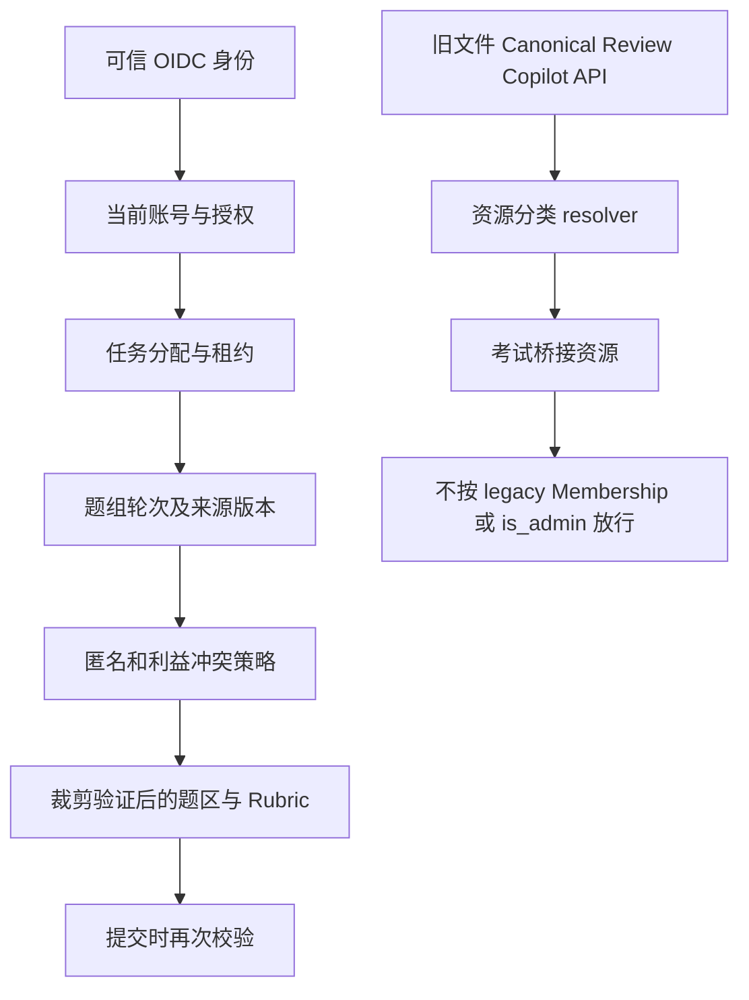

# 单校岗位、资源范围与敏感数据授权

**设计建议，待独立审查，尚未实施。** 现有 teacher/admin 合同见 [当前权限矩阵](../security/http-permissions.md)；本文件不宣称已替换 `User.is_admin`。依据[需求第 3、15 节](requirements/school-exam-baseline-v1.md)。

## 1. 可信身份和两类主体

现有 Principal(user_id, issuer, subject, expires_at, is_admin) 保持兼容。JWT 只证明 issuer/sub 的身份，数据库 User.is_active 及实时授权才决定操作。新增内部 AccessContext 包装 Principal，不修改旧评分文档身份字段：

```text
AccessContext
  principal: existing Principal
  authorization_revision: 服务端读取的当前版本
  workspace: 请求入口，仅导航上下文，不是凭据
  action: 服务端路由/服务固定动作
  resource: 数据库解析的真实资源及父链
  constraints: 匿名模式、任务轮次、回避、可见字段、时限
```

设备独立 DevicePrincipal(device_id, credential_id, expiry, upload_scope)。受限凭据哈希存储、可撤销/轮换、短期 upload session；不能冒充教师、授角色、读取任意 S3。学校采集客户端仅上传已分配 batch/session；断网续传仍校验当前凭据。第一 B 闭环可先只支持 OIDC 人工上传，设备功能关闭直到独立验收。

## 2. 固定动作目录，不接受自由执行权限

PermissionDefinition 由版本控制的服务端目录提供。自定义岗位只能选择目录动作；管理员不能新增 SQL、URL、Python 或通配脚本。新路由仍遵循现有精确方法/路径 fail-closed 思想。

| 动作族 | 支持范围/关键动作 | 最小数据投影 |
|---|---|---|
| identity/organization | account.provision/activate、organization.read/manage、role.define/grant/revoke | 内部账号及必要组织，不含答卷 |
| paper | paper.read/edit/lock、rubric.version | 题本/答案限命题角色；阅卷仅本任务 Rubric |
| exam | exam.create/configure、roster.import/lock、participation.verify | 名单按场次/班级，最少身份字段 |
| scan | batch.create/upload、page.qc、split.edit/confirm、identity.verify、script.remediate | 当前批次原页；identity.verify 才能查该场次名单 |
| marking | task.read/claim/submit、plan.manage、task.reassign、quality.sample、arbitration.submit | 分配题区、必要证据/评分细则，不是整卷 |
| results | result.preview、result.check、result.approve、result.publish、result.correct | 指定结果/班级；排名/导出单独敏感动作 |
| restricted access | identity.reveal、script.full.read、audit.read、breakglass.issue | 限时、理由审计；不通过普通 task.read 附带 |
| teaching | homework.assign/read/review、class.analysis.read、copilot.use | 任教范围内允许资料，不能扩展到跨班卷 |
| operations | system.status/config、device.provision/revoke | 技术状态，不含学生答案/标准答案 |

结果发布动作只在 E 上线；在 B 注册权限名可供设计审核，但不存在执行端点，不能靠 UI 勾选启用。

## 3. 岗位模板和工作空间

`是`表示模板可被授予该动作族，**仍须指定资源范围并满足状态门禁**，不是全校通行证。

| 岗位模板 | 主要动作 | 默认工作空间 | 不默认具备 |
|---|---|---|---|
| 系统运维管理员 | 系统状态/部署、设备凭据、账号技术维护 | 管理 | 学生原卷、答案、评分、发布、给自己业务角色 |
| 教务/考务管理员 | 考试配置、名单、批次归属、进度 | 考务、扫描 | 改写历史评分、直接发布/无理由身份揭示 |
| 年级负责人 | 本年级组织/考试进度和授权分析 | 教学、考务 | 其他年级、无关学科原卷 |
| 学科负责人 | 学科试卷审批/阅卷计划协作 | 教务、阅卷组长 | 其他学科和完整学生档案 |
| 任课教师 | 布置作业、任教班作答/允许结果分析 | 我的工作台、教学 | 任课关系推导跨班阅卷权限 |
| 命题教师 | 指定试卷编制、答案/Rubric、锁版 | 考务试卷区 | 扫描身份、全体考生成绩 |
| 扫描操作员 | 指定批次上传、质检、分卷 | 扫描 | 标准答案、评分、全校名单；身份核验需另授 |
| 阅卷教师 | 指定场次/题组/轮次任务领取和提交 | 阅卷 | 考生身份、整卷/总分、另一独立评分 |
| 阅卷组长 | 指定题组计划、分配/回收、抽检和安排仲裁 | 阅卷组长 | 修改别人不可变记录、未经授予自行终评 |
| 成绩审核人员 | 指定场次完整性检查/审批 | 考务成绩 | 自动拥有发布/改分权限 |
| 成绩发布人员 | 批准后向指定范围发布/撤回 | 考务成绩 | 跳过检查、自批自发、编辑原始评分 |

同一人可多岗位；学校可复制模板组合允许动作，模板是起点，不硬编码为唯一角色枚举。工作空间显示来自服务端 capability intersection；前端可见不等于有权执行。

## 4. RBAC + 资源属性模型

纯 RBAC 无法表达“高二数学第 18 题第二轮”，纯 ABAC 易变成无约束规则语言。采用固定动作 RBAC + **类型化资源范围与系统强制约束**。

建议增量实体：

- Role(id, name, current_revision, builtin/custom)，RoleRevision(id, role_id, revision, state)，RolePermission(role_revision_id, permission_code) 唯一。
- RoleGrant(id, user_id, role_revision_id, scope_id, valid_from/until, revoked_at, granted_by)，AuditEvent 记录授予/撤销前后摘要。
- AuthorizationScope(id, kind, parent_scope_id 可空) 为注册资源范围；TypedBinding 通过专用 FK 表关联 school/grade/subject/admin_class/teaching_class/exam/session/paper/question/question_group/round/resource。
- 一个 ScopePredicate 存**同一行授权的组合条件**，例如 session S AND group G AND round R；不能将一行的数学权限和另一行的全年级范围交叉拼成全级数学授权。所有维度存在 FK 和父子一致性验证，不使用任意 JSON 程序。
- 任意指定资源支持的 resource_kind 为固定枚举，并由各域 resolver 校验真实 FK/层级；不能仅写一个未经验证的 generic UUID 就授权。
- Scoped membership/TeachingAssignment 可经服务端映射为固定 teaching 动作；不直接给考试任务权限。

合成规则：对某 action，存在**一个有效 grant**满足该资源全部 predicate 才构成候选 allow；多行 grant 是候选 allow 的并集；系统约束（匿名/回避/冻结/账号停用/来源不齐）统一再取交集，拒绝优先。多个教师岗位不能组合出未授予的特权。

角色修改不静默扩大既有授权：创建 RoleRevision，现有 RoleGrant 固定旧版；经审批迁移到新版并原子换 current grants。收紧/紧急停用可撤销整个旧版本，后续请求立即拒绝；不得在长期 JWT 内缓存权限列表。

## 5. 自定义岗位、授权、撤权和防提权

1. role.define 只创建待审核岗位版本，不能据此给自己发 grant。
2. role.grant 只能授予自己**可委派权限目录和范围**的子集；运维配置权限不自动具有教学委派权限。服务端验证 grantor authority，不相信客户端 can_delegate。
3. 高敏：全校原卷/身份揭示、全校数据导出、业务管理员、权限目录升级、成绩审批发布、紧急破窗建议双人确认；请求者≠审批者；操作令牌一次性、限定资源/理由/有效期。学校需确认具体清单；未确认时禁用这些高敏新增动作。
4. 写事务重新检查 User、RoleGrant/RoleRevision、resource/current task；与撤销使用兼容行锁次序，明确以 COMMIT 序列化。撤销在其 COMMIT 后的新操作立即生效；已先取得授权读锁并提交的操作可先于撤销完成，不能承诺撤权倒流取消已提交事实。
5. 长 S3/模型 I/O 前后检查；文件流停止后续新块前重验/短有效读取票据，已经发送字节不可收回。禁止长 DB 事务覆盖整个下载。
6. request_id 恢复也须先当前授权，不能让幂等查询成为已撤权用户的数据后门。账号停用令所有岗位失效。
7. 审计追加权限由业务服务内可信操作者写，普通教师/扫描设备无更改入口。授予/撤销与审计同事务；审计失败不产生授权成功事实。

## 6. 匿名跨班阅卷：必须后端阻断



- 阅卷端只返回匿名 task_public_id 与 question_key、必要题干/Rubric、经检查的题区图像/文本；不返回 participation/student/class/submission UUID、整卷 Key、姓名、考号、总分或其他题评分。路径/响应错误不提供身份反查。
- 不能只裁掉首页：笔迹区域可能自署姓名，需保护区/人工遮罩验证；安全裁剪无法确认则任务 unavailable 转最小授权的处理人员，不能发整页凑数。
- 后端旧接口逐项封堵：作业详情含答案、workbench/提交列表、Submission 原文件、Parsed Markdown、Canonical 页/资产、Alignment、AnswerReview/GradeReview、受控 CLI/Copilot 工具。发现 exam-protected resource 即走新策略/拒绝，不回退旧整卷成员。
- 仅给任务权限不创建 AssignmentMembership。即使用户另有任课教师/全校 admin 身份，**同一匿名考试受保护期内**也不凭切工作空间拿整卷；只允许另行批准的身份核对/仲裁破窗，记录理由并执行回避策略。
- 旧 ordinary homework 不受此新匿名限制；明确资源分类，不能在未知分类时默认 legacy。
- OMR/AI 建议是独立候选，双评计划规定是否显示；不提前把另一评的分数放进 API 或浏览器响应再用 CSS 隐藏。

## 7. 现有 is_admin 的兼容迁移

当前 `require_assignment` 的数据库 admin 绕过会员限制是已测试历史合同，不在本轮直接改掉。

1. 增量上线 resource classification；新 ExamSession/Paper/桥接 Submission 默认 `exam_protected`。所有旧敏感路径先识别，考试资源绝不进入 legacy admin 捷径。
2. legacy Assignment 仍按原规则服务；审计现有 admin 及成员关系，输出脱敏授权预演和受影响清单，不自动把 admin 映射成全校阅卷/发布人。
3. 学校审批后分别配置 system_operator、academic/exam grants；过渡期显式 legacy access entitlement，仅限历史作业，带期限与审计。
4. 灰度收紧 legacy 全局访问，双轨决策对比后切换；撤销过渡权限前通知、测试原件/审核/检索路径。`/me.role` 继续 teacher/admin 供旧 UI，新增 `/me/contexts` 返回真实动作/范围摘要；旧 admin 文案标为兼容管理身份，不等同新教学权限。
5. 最后独立 PR 移除 legacy global bypass。保留历史 actor UUID、审核和审计，不迁改原始学生资料。没有新策略覆盖的敏感路由 fail closed。

## 8. 权限测试门槛

每个资源 API：无 Token/未知 kid/过期/伪造 role、未映射/停用账号、错 Session/Paper、跨班/跨题/跨轮、请求中伪造 scope、撤权后重放、长 I/O 中撤权、管理员兼容旁路、设备冒充、DB 故障；均需真实独立 PostgreSQL 测试。匿名再遍历旧 34 操作与所有新资产下载验证响应体与字节不泄露，而非只断言页面 403。详见[验收矩阵](../evaluation/business-acceptance-matrix.md)。
